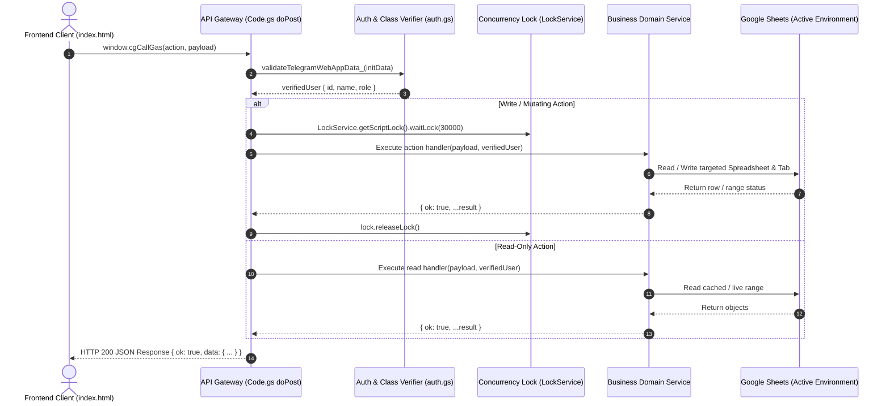
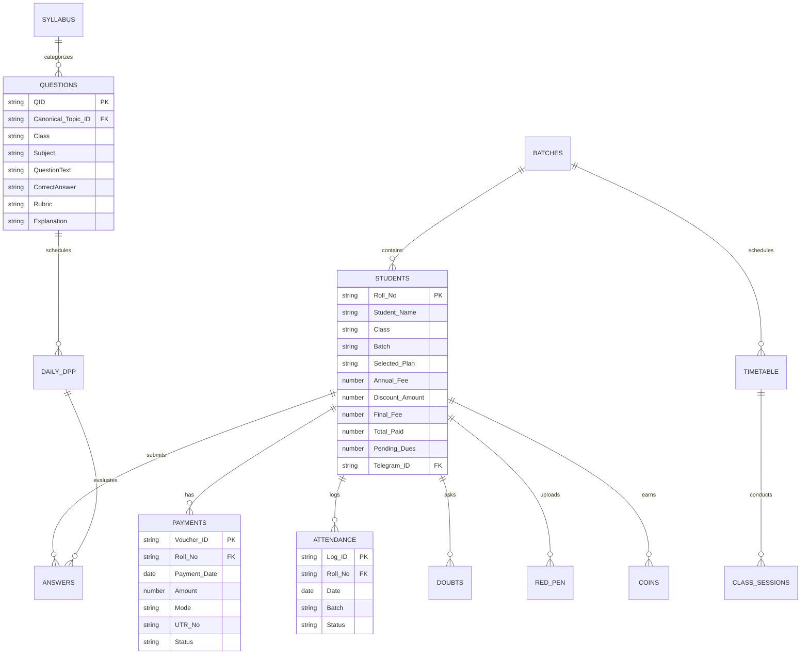

# COMMERCE GYAN MASTER APP — API, BACKEND & DATABASE SPECIFICATION

> **Architecture Depth:** Comprehensive Endpoint Catalog, Payload Schemas, and 7-Spreadsheet / 94-Tab Relational Database Specification.  
> **Source Verification:** Extracted directly from `backend/Code.gs`, `backend/*.gs`, and live Google Sheets metadata.

---

## 1. HTTP Communication Architecture

All communication between the frontend clients (`index.html`, `frontend/admin/books.html`, `studio/index.html`) and the Google Apps Script backend occurs over HTTPS via a unified JSON RPC-style protocol.



### Standard Response Envelope
```json
{
  "ok": true,
  "data": { ... },
  "message": "Operation completed successfully"
}
```
*In case of error:*
```json
{
  "ok": false,
  "error": "CLASS_MISSING: Students sheet me aapki Class (11 ya 12) likhi nahi hai. Gyan Sir se contact kijiye."
}
```

---

## 2. Comprehensive API Endpoints Catalog

| Endpoint Action | Allowed Role | Target Handler (`.gs`) | Sheets & Tabs Read / Written | Purpose & Key Payloads |
|:---|:---:|:---|:---|:---|
| `getStudentMiniAppBootstrap` | Student | `Code.gs` -> `apiGetHomeDashboard_` | **Read:** `FEE_MGMT -> Students`, `MASTER_ERP -> Weekly_Timetable`, `Notices` | Bootstraps student app with personal profile, active batch, and day's classes. |
| `getWeeklyTimetable` | Public | `Code.gs` -> `getWeeklyTimetable()` | **Read/Write:** `MASTER_ERP -> Weekly_Timetable` | Returns full Mon–Sat class routine with class modes. |
| `saveWeeklyTimetable` | Admin | `Code.gs` -> `saveWeeklyTimetable()` | **Write:** `MASTER_ERP -> Weekly_Timetable` | Appends or updates routine slots with `Mode` (`Offline`/`CG App`/`YouTube`). |
| `saveTimetableSlot` | Admin | `Code.gs` -> `saveWeeklyTimetable()` | **Write:** `MASTER_ERP -> Weekly_Timetable` | Saves a single dated class slot and notifies students. |
| `getSyllabusTree` | Public | `Code.gs` -> `getSyllabusTree()` | **Read:** `SYLLABUS -> Master_Syllabus` | Returns 797 CBSE subtopics filtered by board, class (11/12), and subject. |
| `setActiveSubtopic` | Admin | `Code.gs` & `questions.gs` -> `setActiveSubtopic()` | **Write:** `TELEGRAM -> Settings!B2`, `MASTER_ERP -> Weekly_Timetable` | Locks active subtopic for today's class and tonight's 7:30 PM DPP. |
| `getDailyQuestion` | Student | `questions.gs` -> `apiGetDailyQuestion_` | **Read:** `QUESTION_BANK -> DailyPackage`, `MASTER_Q_REPO` | Fetches today's 4-option challenge questions with ghost timers. |
| `submitStudentQuizAttempt` | Student | `questions.gs` -> `apiSubmitAnswer_` | **Write:** `QUESTION_BANK -> StudentAnswers`, `MASTER_ERP -> Coin_Ledger` | Validates student quiz answers, grades accuracy, logs time, and awards +20 coins. |
| `getPracticeQuestions` | Student | `Code.gs` -> `handleGetPracticeQuestions_` | **Read:** `QUESTION_BANK -> QuestionBank`, `MASTER_Q_REPO` | Returns filtered questions for custom chapter practice. |
| `askDoubt` / `askDoubtGemini` | Student | `doubts.gs` -> `apiAskDoubt_` | **Write:** `QUESTION_BANK -> Doubts` | Calls Google Gemini 2.5 Flash API with NCERT persona to solve doubt. |
| `askVoiceDoubt` | Student | `doubts.gs` -> `apiAskVoiceDoubt_` | **Write:** `QUESTION_BANK -> Doubts` | Transcribes audio query and generates answer via Gemini API. |
| `submitRedPenCopy` | Student | `redpen.gs` -> `apiSubmitRedPenCopy_` | **Write:** `QUESTION_BANK -> Student_Red_Pen`, Google Drive | Uploads register photo to Google Drive and runs vision step-marking audit. |
| `getStudentFeeLedger` | Student / Admin | `fees.gs` -> `getStudentFeeLedger()` | **Read:** `FEE_MGMT -> Students, Payments, Plans` | Returns student's fee plan, passbook payment rows, and pending balance. |
| `recordPaymentIntimation` | Student | `fees.gs` -> `recordPaymentIntimation()` | **Write:** `FEE_MGMT -> Payments` | Submits UTR and transaction ID with status `PENDING_VERIFICATION`. |
| `recordFeePayment` | Admin | `fees.gs` -> `recordFeePayment()` | **Write:** `FEE_MGMT -> Students, Payments, Receipts` | Admin verifies UTR, marks paid, and generates receipt voucher. |
| `revokeLateFee` | Admin | `fees.gs` -> `revokeLateFee()` | **Write:** `FEE_MGMT -> Students` | Waives late fee penalty for a specific student. |
| `saveNotice` | Admin | `notices.gs` -> `saveNotice()` | **Write:** `MASTER_ERP -> Notices` | Broadcasts institutional notice to Class 11, Class 12, or All. |
| `deleteNotice` | Admin | `notices.gs` -> `deleteNotice()` | **Write:** `MASTER_ERP -> Notices` | Deactivates an active bulletin notice. |
| `startClassSession` | Admin | `class_sessions.gs` -> `startClassSession()` | **Write:** `MASTER_ERP -> Class_Sessions` | Starts live class timer, logs session ID, triggers absent alerts. |
| `endClassSession` | Admin | `class_sessions.gs` -> `endClassSession()` | **Write:** `MASTER_ERP -> Daily_Class_Recordings` | Concludes class session and publishes chalkboard GoodNotes PDF link. |
| `saveAttendanceBatch` | Admin | `Code.gs` -> `saveAttendanceBatch()` | **Write:** `MASTER_ERP -> Attendance_Logs` | Appends P/A/L attendance records for the entire batch. |
| `sendClassMissedNotices` | Admin | `class_sessions.gs` -> `sendClassMissedNotices()` | **Write:** `TELEGRAM -> Broadcasts` | Sends unlisted recording links to absent students via Telegram. |
| `dispatchDailyDPPAndSubjectivePDF` | Admin / Trigger | `Code.gs` -> `dispatchDailyDPPAndSubjectivePDF()` | **Read:** `QUESTION_BANK -> QuestionBank` **Write:** `DailyQuestions` | Assembles 70% fresh + 30% retention DPP and posts to Telegram channels. |
| `getSwotConfig` | Student / Admin | `Code.gs` -> `getSwotConfig()` | **Read:** `MASTER_ERP -> SWOT_Config` | Returns dynamic fields and teacher manual notes for SWOT receipts. |
| `saveSwotConfig` | Admin | `Code.gs` -> `saveSwotConfig()` | **Write:** `MASTER_ERP -> SWOT_Config` | Saves customizable SWOT fields and personalized teacher remarks. |
| `bindStudentClaimCode` | Student | `auth.gs` -> `bindStudentClaimCode()` | **Write:** `MASTER_ERP -> Claim_Codes`, `FEE_MGMT -> Students` | Links Telegram User ID to student Roll Number via single-use 6-digit claim code. |
| `createBackupArchive` | Admin | `Code.gs` -> `createBackupArchive()` | **Read:** All 7 Google Sheets **Write:** Google Drive Backup Archive | Creates full JSON cloud backup archive of all 7 Spreadsheets. |

---

## 3. Google Sheets Relational Database Architecture (7 Sheets / 94 Tabs)



### Spreadsheet 1: `1. Master ERP` (`1Muw7PEocEQjdXSlwMBCiFVrCtAu-HYJk0fXi1AblUhc`)
* **Total Tabs:** 43 Tabs
* **Primary Key Concept:** Student Roll Number (`Roll_No` e.g., `CG-11-001`, `CG-1201`).
* **Critical Operational Tabs:**
  1. `Weekly_Timetable`: Columns `Day`, `Slot_Index`, `Time_Window`, `Class_Level`, `Subject`, `Topic`, `Slot_Type`, `Notes`, `Updated_At`, `Mode`. (Powers student home schedule and teacher agenda).
  2. `Notices`: Columns `Notice_ID`, `Title`, `Body`, `Class`, `Start_Date`, `End_Date`, `Created_By`, `Created_At`, `Active`. (Institutional bulletins).
  3. `Class_Sessions`: Columns `Session_ID`, `Batch`, `Subject`, `Topic_ID`, `Delivery_Mode`, `Start_Time`, `End_Time`, `Status`. (Classroom lecture logs).
  4. `Daily_Class_Recordings`: Columns `Date`, `Batch`, `Subject`, `Topic`, `Goodnotes_PDF_URL`, `YouTube_URL`, `Created_At`. (Chalkboard notes delivery).
  5. `Attendance_Logs`: Columns `Log_ID`, `Date`, `Batch`, `Roll_No`, `Status` (`P`/`A`/`L`), `Recorded_By`, `Timestamp`. (30-second attendance records).
  6. `Coin_Ledger`: Columns `Transaction_ID`, `Roll_No`, `Coins_Changed`, `Reason`, `Balance_After`, `Timestamp`. (Gamification ledger).
  7. `Claim_Codes`: Columns `Code`, `Roll_No`, `Class`, `Status` (`ACTIVE`/`USED`), `Used_At`, `Telegram_ID`. (Student onboarding claim codes).
  8. `SWOT_Config`: Columns `Field_Key`, `Label`, `Active`, `Manual_Notes_JSON`. (Customizable SWOT receipt options).
  9. `Audit_Log`: Columns `Timestamp`, `Actor`, `Action`, `Details`, `IP_Address`. (System security trail).

---

### Spreadsheet 2: `2. Syllabus Planner` (`1-LrOhyGDDAwxm-eNF-kJX6JldbllQYulZ9wLo_63hFY`)
* **Total Tabs:** 3 Tabs (`Master_Syllabus`, `Chapter_Weightage`, `Setup`)
* **Primary Key Concept:** Canonical Topic ID (`Canonical_Topic_ID` e.g., `C11-ACC-B1-CH05-T01-S01`).
* **Critical Tabs:**
  1. `Master_Syllabus`: 797 rows containing the complete official CBSE Commerce curriculum:
     * Columns: `Class`, `Subject`, `ChapterNo`, `ChapterName`, `Topic_ID`, `Topic_Name`, `Subtopic`, `Canonical_Topic_ID`, `Delivery_Medium` (`Offline`/`CG_App`/`YouTube`), `Status` (`Planned`/`In Progress`/`Completed`), `YouTube_URL`, `Goodnotes_URL`, `Board`.

---

### Spreadsheet 3: `3. Question Bank` (`1VI89cSIa0PcL2rHzEmiEgc1lgpmvWLgyIXZ7Pb5I2bs`)
* **Total Tabs:** 12 Tabs
* **Primary Key Concept:** Question ID (`QID` e.g., `Q-0001`, `11ACC-CH01-001`).
* **Critical Tabs:**
  1. `QuestionBank`: Active pool of approved MCQs (Columns: `QID`, `Class`, `Subject`, `Chapter`, `Topic`, `Question`, `OptA`, `OptB`, `OptC`, `OptD`, `CorrectIdx`, `Rubric`, `Explanation`, `Ghost_Seconds`, `ApprovalStatus`).
  2. `DailyQuestions`: Daily schedule of published DPPs (Columns: `Date`, `QID`, `Class`, `Subject`, `Ghost_Target_Sec`).
  3. `StudentAnswers`: Live attempt logs (Columns: `Timestamp`, `TelegramID`, `StudentName`, `QID`, `AnswerText`, `Score`, `TimeTaken_Seconds`, `BeatGhost_Status`).
  4. `Student_Red_Pen` & `RedPen_Submissions`: Handwritten answer copies (Columns: `Timestamp`, `Roll_No`, `Subject`, `Drive_URL`, `Status`, `Feedback`).
  5. `Doubts`: AI mentor queries (Columns: `Timestamp`, `TelegramID`, `StudentName`, `Question`, `Answer`, `InputType`, `AudioDuration_Sec`, `Status`).
  6. `Revision_Queue`: Spaced repetition Leitner box (Columns: `TelegramID`, `QID`, `LastAttempt`, `NextReview`, `Attempts`, `Status`).
  7. `Leaderboard`: Student rankings (Columns: `TelegramID`, `StudentName`, `Roll_No`, `Score`, `Badges`, `Coins`, `Rank`, `Streak_Days`).

---

### Spreadsheet 4: `4. Fee Management` (`1Dka1y2r-2cDjkZxDyJZ__-GOqvNjwIhR9Eurvu3srwI`)
* **Total Tabs:** 7 Tabs (`Plans`, `Students`, `Payments`, `Fee_Schedule`, `Fee_Summary`, `Fee_Reminders`, `Receipts`)
* **Primary Key Concept:** Student Roll Number (`Roll_No`) & Voucher ID (`Voucher_ID`).
* **Critical Tabs:**
  1. `Students`: Master fee profile per student:
     * Columns: `Roll_No` (A), `Student_Name` (B), `Parent_Name` (C), `Class` (D), `Batch` (E), `Contact` (F), `Enrolment_Date` (I), `Fee_Plan` (K), `Annual_Fee` (P), `Discount_Amount` (Q), `Final_Fee` (R), `Total_Paid` (T), `Pending_Dues` (U), `Status` (V).
  2. `Payments`: Individual transaction passbook:
     * Columns: `Voucher_ID`, `Roll_No`, `Payment_Date`, `Amount`, `Payment_Mode`, `UTR_Reference`, `Late_Penalty`, `Coins_Discount`, `Net_Amount`, `Status` (`PAID`/`PENDING_VERIFICATION`).
  3. `Plans`: Standard tuition rate cards (Monthly Combo ₹1,200, Quarterly ₹3,300, Annual ₹10,000).

---

### Spreadsheet 5: `5. Telegram Delivery` (`1KslovmOPwDvCStvjljzhvC4wRpRnTWplcamTq_10pQY`)
* **Total Tabs:** 12 Tabs (`Bot_Logs`, `Daily_Class_Notes`, `Lesson_Plans`, `Health_Report`, `Render_Log`, `PDF_Log`, `Subjective_PDF_Log`, `Broadcasts`, `Settings`, `Errors`, `Audio_Pills_Log`, `Daily_Control`)
* **Critical Tabs:**
  1. `Settings`: Key-Value administrative parameters:
     * `Key: ACTIVE_SUBTOPIC_11` -> JSON payload of Class 11 locked topic.
     * `Key: ACTIVE_SUBTOPIC_12` -> JSON payload of Class 12 locked topic.
  2. `Broadcasts`: Telegram broadcast archive (message ID, sent timestamp, recipient batch).

---

### Spreadsheet 6: `6. Books & Expenses` (`15bM321-hqqvbZRsSKKUfYNwWcOkv9l3EsOAodLZhksQ`)
* **Total Tabs:** 6 Tabs (`Expenses`, `Assets`, `Liabilities`, `Capital_Drawings`, `Opening_Balances`, `Monthly_Reports`)
* **Critical Tabs:**
  1. `Expenses`: Direct coaching operating costs (Rent, Electricity, Chalk, Internet, Printing).
  2. `Assets`: Physical commercial textbook stock (TS Grewal, Sandeep Garg) and classroom hardware.

---

### Spreadsheet 7: `7. Master Question Repository` (`1FMk5KBCaEBLj7rwmGI9lIEpM02aGWrC-6tD8GXApDCY`)
* **Total Tabs:** 11 Tabs (`DASHBOARD`, `11_ACC`, `11_BST`, `11_ECO_MICRO`, `11_STAT`, `12_ACC`, `12_BST`, `12_ECO_MACRO`, `12_ECO_IED`, `PROMPT_ENGINE`, `LOOKUP_DATA`)
* **Primary Key Concept:** Canonical QID across 8 Subject Vaults.
* **Production Schema (Cols AA to AU):**
  * `QID`, `Canonical_Topic_ID`, `ChapterNo`, `ChapterName`, `Topic`, `Subtopic`, `QuestionType`, `Marks`, `Difficulty`, `QuestionText`, `OptA`, `OptB`, `OptC`, `OptD`, `CorrectAnswer`, `Official_CBSE_Marking_Scheme`, `Explanation_NCERT`, `Trap_Alert`, `RealWorld_SharkTank_Hint`, `Status`, `QA_Audit_Status` (`✅ READY TO APPROVE`).
