# COMMERCE GYAN MASTER APP — COMPLETE VISUAL MIND MAP

> **Architecture Depth:** Full Application Hierarchy (Modules, Screens, Tabs, Functions, APIs, and Sheets)  
> **Target Files:** `index.html`, `frontend/admin/books.html`, `studio/index.html`, `backend/*.gs`

---

## 1. Visual Mind Map Diagram (Mermaid)

```mermaid
graph LR
    %% Styles
    classDef root fill:#4F46E5,color:#fff,stroke:#312E81,stroke-width:3px;
    classDef mod fill:#818CF8,color:#fff,stroke:#4338CA,stroke-width:2px;
    classDef scr fill:#C7D2FE,color:#1E1B4B,stroke:#6366F1,stroke-width:2px;
    classDef tab fill:#FEF3C7,color:#78350F,stroke:#D97706,stroke-width:1px;
    classDef fn fill:#D1FAE5,color:#064E3B,stroke:#059669,stroke-width:1px;

    ROOT["COMMERCE GYAN<br/>MASTER ECOSYSTEM"]:::root

    %% Modules
    MOD_STU["1. Student Mobile App<br/>(Telegram WebApp CGHELP)"]:::mod
    MOD_TEA_OPS["2. Teacher Daily Ops<br/>(Mobile / Tablet Quick Cockpit)"]:::mod
    MOD_TEA_ERP["3. Teacher Command ERP<br/>(Desktop Admin Multi-Module)"]:::mod
    MOD_COMP["4. Specialized Tools<br/>(Books & Studio Controllers)"]:::mod
    MOD_SHARED["5. Core Shared Services<br/>(Auth, Caching, Triggers, Sheets)"]:::mod

    ROOT --> MOD_STU
    ROOT --> MOD_TEA_OPS
    ROOT --> MOD_TEA_ERP
    ROOT --> MOD_COMP
    ROOT --> MOD_SHARED

    %% Student App Tabs
    MOD_STU --> STU_HOME["Home Tab<br/>(#tgTab-home)"]:::scr
    MOD_STU --> STU_PAD["Padhai Tab<br/>(#tgTab-syllabus)"]:::scr
    MOD_STU --> STU_DOUBT["Doubt Tab<br/>(#tgTab-doubt)"]:::scr
    MOD_STU --> STU_PROG["Progress Tab<br/>(#tgTab-progress)"]:::scr
    MOD_STU --> STU_FEES["Fees Tab<br/>(#tgTab-fees)"]:::scr
    MOD_STU --> STU_MODALS["Full-Screen Overlays<br/>(MCQ, Red-Pen, Chapters, SWOT)"]:::scr

    STU_HOME --> STU_H1["Aaj Ki Classes & Routine"]:::tab
    STU_HOME --> STU_H2["Fee Status & Haaziri Banner"]:::tab
    STU_HOME --> STU_H3["Naya Notice Popup"]:::tab
    STU_HOME --> STU_H4["Speed Challenge Runner Button"]:::tab

    STU_PAD --> STU_P1["Choose Chapters Modal (4 Subj)"]:::tab
    STU_PAD --> STU_P2["CBSE Roadmap (3-Level Tree)"]:::tab
    STU_PAD --> STU_P3["Chalkboard GoodNotes PDFs"]:::tab
    STU_PAD --> STU_P4["Self-Paced Quiz Launcher"]:::tab

    STU_DOUBT --> STU_D1["Gyan Sir AI Mentor (Gemini 2.5)"]:::tab
    STU_DOUBT --> STU_D2["4 Subject Prompt Chips"]:::tab
    STU_DOUBT --> STU_D3["Voice Audio Doubt Recorder"]:::tab
    STU_DOUBT --> STU_D4["Direct WhatsApp Connect"]:::tab

    STU_PROG --> STU_PR1["CBSE 80/80 Target Scorecard"]:::tab
    STU_PROG --> STU_PR2["Metric Breakdown Popups"]:::tab
    STU_PROG --> STU_PR3["Chapter Mastery Heatmap"]:::tab
    STU_PROG --> STU_PR4["Red-Pen Submission History"]:::tab
    STU_PROG --> STU_PR5["Batch Leaderboard & CG Coins"]:::tab

    STU_FEES --> STU_F1["Tuition Profile & Dues"]:::tab
    STU_FEES --> STU_F2["Passbook Payment History"]:::tab
    STU_FEES --> STU_F3["SWOT Smart Receipt Modal"]:::tab
    STU_FEES --> STU_F4["Payment Intimation (UTR Form)"]:::tab
    STU_FEES --> STU_F5["Dynamic UPI QR Generator"]:::tab

    %% Teacher Daily Ops Tabs
    MOD_TEA_OPS --> OPS_AAJ["Aaj Tab (Checklist)"]:::tab
    MOD_TEA_OPS --> OPS_TOPIC["Topic Tab (Pre-Class Lock)"]:::tab
    MOD_TEA_OPS --> OPS_START["Start Tab (30s Attendance)"]:::tab
    MOD_TEA_OPS --> OPS_END["End Tab (Upload PDF & Close)"]:::tab
    MOD_TEA_OPS --> OPS_DPP["DPP Tab (7 PM Dispatcher)"]:::tab
    MOD_TEA_OPS --> OPS_MORE["More Tab (Settings & Tools)"]:::tab

    %% Teacher ERP Modules
    MOD_TEA_ERP --> ERP_M1["Module 1: Today & Timetable"]:::scr
    MOD_TEA_ERP --> ERP_M2["Module 2: Students & Pipeline"]:::scr
    MOD_TEA_ERP --> ERP_M3["Module 3: Classroom & Grading"]:::scr
    MOD_TEA_ERP --> ERP_M4["Module 4: Finance & Fee Ledger"]:::scr
    MOD_TEA_ERP --> ERP_M5["Module 5: Content, DPP & Sync"]:::scr

    ERP_M1 --> ERP_M1_1["Command Dashboard (#subtab-today-dash)"]:::fn
    ERP_M1 --> ERP_M1_2["Weekly Routine Grid (#subtab-today-timetable)"]:::fn
    ERP_M1 --> ERP_M1_3["Lesson Planner + AI (#subtab-today-lessons)"]:::fn
    ERP_M1 --> ERP_M1_4["Academic Calendar (#subtab-today-calendar)"]:::fn

    ERP_M2 --> ERP_M2_1["Inquiry CRM Pipeline (#subtab-students-pipeline)"]:::fn
    ERP_M2 --> ERP_M2_2["Student Directory (#subtab-students-directory)"]:::fn
    ERP_M2 --> ERP_M2_3["Parent Communication Log (#subtab-students-parentcomm)"]:::fn

    ERP_M3 --> ERP_M3_1["30s Attendance Grid (#subtab-classroom-attendance)"]:::fn
    ERP_M3 --> ERP_M3_2["REC-01 Recovery Drill (#subtab-classroom-rec01)"]:::fn
    ERP_M3 --> ERP_M3_3["Batch Analytics & Radar (#subtab-classroom-analytics)"]:::fn

    ERP_M4 --> ERP_M4_1["Fee Ledger & Overdue (#subtab-finance-fees)"]:::fn
    ERP_M4 --> ERP_M4_2["Defaulter Alerts (#subtab-finance-defaulters)"]:::fn
    ERP_M4 --> ERP_M4_3["Printable SWOT Receipt (#subtab-finance-receipt)"]:::fn

    ERP_M5 --> ERP_M5_1["Syllabus Planner (#subtab-system-curriculum)"]:::fn
    ERP_M5 --> ERP_M5_2["Question & DPP Engine (#subtab-system-dpp)"]:::fn
    ERP_M5 --> ERP_M5_3["Review Vault & Coins (#subtab-system-vault)"]:::fn
    ERP_M5 --> ERP_M5_4["Backup Archives & Audit (#subtab-system-audit)"]:::fn
```



---

## 2. Complete Structural Mind Map (Tree Outline)

```text
COMMERCE GYAN MASTER APPLICATION ECOSYSTEM
│
├── [MODULE 1] STUDENT TELEGRAM MINI APP ("CGHELP")
│   ├── Screen 1: Home Dashboard Tab (#tgTab-home)
│   │   ├── Component: Student Profile Header (Roll, Name, Batch, Class Level, Coins, Haaziri %)
│   │   │   ├── Action: Change Roll Number / Switch View (viewAsStudentRollNo)
│   │   │   └── Backend: getStudentMiniAppBootstrap -> Students sheet
│   │   ├── Component: Fees Status Card
│   │   │   ├── Display: Pending Dues, Total Paid, Annual Fee, Status Badge
│   │   │   ├── Action: Click opens Fees Tab (#tgTab-fees)
│   │   │   └── Backend: Fee Management -> Students (Cols P, Q, R, T, U)
│   │   ├── Component: Aaj Ki Classes (Daily Schedule)
│   │   │   ├── Display: Subject, Time, Topic, Mode (Offline / CG App / YouTube)
│   │   │   ├── Action: Click opens Slot Details Popup Modal (#stuDetailModal)
│   │   │   └── Backend: MASTER_ERP -> Weekly_Timetable
│   │   ├── Component: Haaziri Record Card
│   │   │   ├── Display: Present count, Absent count, Attendance % circular badge
│   │   │   └── Backend: MASTER_ERP -> Attendance_Logs
│   │   ├── Component: Naya Notice Alert Card
│   │   │   ├── Display: Latest active bulletin title, tag, date
│   │   │   ├── Action: Click "Details dekho" opens Notice Detail Popup (#stuDetailModal)
│   │   │   └── Backend: MASTER_ERP -> Notices
│   │   ├── Component: Today's Active Topic Card
│   │   │   ├── Display: Class-filtered locked topic for tonight's DPP
│   │   │   └── Backend: TELEGRAM -> Settings!B2 (ACTIVE_SUBTOPIC)
│   │   ├── Component: Daily MCQ & Speed Challenge Card
│   │   │   ├── Display: 4-Option Ghost Runner teaser, topic badge
│   │   │   ├── Action: Click "⚡ Start Daily MCQ / DPP" triggers handleOpenDailyMcq
│   │   │   └── Backend: apiGetDailyQuestion_ -> Question Bank / Master Repo
│   │   ├── Component: Weekly Schedule & Upcoming Topics (Mon-Sat Agenda)
│   │   │   ├── Display: Class 11 slots, colored mode badges (🏢 Offline, 📱 CG App, 🔴 YouTube)
│   │   │   └── Action: Click slot opens timing, topic, and mode details
│   │   └── Component: Today's Batch Lectures
│   │       ├── Display: Daily class chalkboard PDF links & YouTube video links
│   │       └── Backend: TELEGRAM -> Daily_Class_Notes
│   │
│   ├── Screen 2: Padhai & Curriculum Roadmap Tab (#tgTab-syllabus)
│   │   ├── Component: Today's Practice Card
│   │   │   ├── Display: Question count, pending status
│   │   │   └── Action: Click "Start Practice" starts Daily DPP
│   │   ├── Component: Chapter Practice ("Choose Chapters" Modal Launcher)
│   │   │   ├── Action: Click "Choose Chapters" opens #stuChooseChaptersModal
│   │   │   ├── Sub-features: 4 Class 11 Subjects (Accounts, BST, Economics, Statistics)
│   │   │   └── Output: Launches custom drill filtered by selected chapters
│   │   └── Component: CBSE Curriculum Roadmap & Practice Vault
│   │       ├── Subject Selector Cards: 📊 Accountancy, 📑 Business Studies, 📈 Economics, 🧮 Statistics
│   │       ├── Dynamic Progress Bar: Ch count, Topics count, Subtopics count, % Completed
│   │       └── 3-Level Expandable Syllabus Accordion:
│   │           ├── Level 1: Subject (Click reveals all chapters)
│   │           ├── Level 2: Chapter Accordion (<details> 📂 Ch 1 to Ch 11)
│   │           ├── Level 3: Topic Accordion (<details> 🔹 Core Concepts & Numerical)
│   │           └── Level 4: Subtopics with individual Status (✓ Completed, ⏳ In Progress, ⏳ Upcoming)
│   │               └── Delivery Mode Badges: 🏢 Offline, 📱 CG App, 🔴 YouTube
│   │               └── Actions: ▶ Watch Lecture, 📄 Offline GoodNotes PDF, 📲 Open in CG App
│   │
│   ├── Screen 3: Doubt & AI Mentor Tab (#tgTab-doubt)
│   │   ├── Component: Gyan Sir AI Mentor Chat Stream
│   │   │   ├── Display: Step-by-step NCERT Commerce guidance
│   │   │   └── Backend: apiAskDoubt_ -> Google Gemini 2.5 Flash API (45s client timeout)
│   │   ├── Component: 4 Subject Pills (Accounts, BST, Economics, Statistics)
│   │   ├── Component: Recommended Quick Prompt Chips (e.g. BRS Overdraft, Fayol Principles)
│   │   │   └── Action: Click populates #stuDoubtInput and focuses (no auto-send)
│   │   ├── Component: Voice Audio Doubt Recorder (Web Audio API)
│   │   │   ├── Action: Hold mic button to record voice query
│   │   │   └── Backend: askVoiceDoubt -> Base64 audio transcription via Gemini
│   │   └── Component: Direct WhatsApp Button
│   │       └── Action: Redirects to Gyan Sir's WhatsApp (+91 98350 11201) with pre-filled question
│   │
│   ├── Screen 4: Progress & Leaderboard Tab (#tgTab-progress)
│   │   ├── Component: CBSE Subjective Copy Check Card
│   │   │   ├── Display: Compact "Open Red-Pen" action card
│   │   │   └── Action: Opens #stuRedPenModal for register photo upload
│   │   ├── Component: CBSE 80/80 Target Progress Scorecard
│   │   │   ├── Display: Predicted score (e.g. 72/80), Progress bar
│   │   │   └── 4 Preparation Pillars: Attendance (94%), DPP Habit (92%), Unit Tests (88%), MCQ Accuracy (90%)
│   │   ├── Component: Interactive Metric Chips
│   │   │   ├── Overall Accuracy (92%) -> Click opens Subject-wise accuracy breakdown popup
│   │   │   ├── Strongest Chapter -> Click opens Chapter strengths popup
│   │   │   └── Leak Area -> Click opens Chapter weakness & remedial guidance popup
│   │   ├── Component: Chapter Mastery Breakdown (Class 11 CBSE Heatmap)
│   │   │   └── Display: Ch 1 (100% Mastered), Ch 2 (95%), Ch 3 (88%), Ch 5 BRS (65%), Ch 7 (54% Alert)
│   │   ├── Component: Past Checked Copies (Red-Pen History)
│   │   │   └── Display: Checked copy count, Drive links, and teacher step-marking feedback
│   │   └── Component: Batch Leaderboard (Privacy-Masked)
│   │       ├── Display: Top 10 Commerce Stars, Roll, CG Coins, Streaks
│   │       └── Backend: QUESTION_BANK -> Leaderboard
│   │
│   ├── Screen 5: Tuition Fees & Ledger Tab (#tgTab-fees)
│   │   ├── Component: Enrolment & Fee Profile Card
│   │   │   ├── Display: Date of Joining, Plan (Monthly Combo / Quarterly), Current Due, Next Due Date
│   │   │   └── Backend: FEE_MGMT -> Students (Cols P, Q, R, T, U)
│   │   ├── Component: Passbook Payment History
│   │   │   ├── Display: Receipt number, date, mode (UPI/Cash), penalty, coins discount, final amount
│   │   │   └── Backend: FEE_MGMT -> Payments
│   │   ├── Component: SWOT Smart Receipt & Voucher Launcher
│   │   │   ├── Action: Click "View SWOT Smart Receipt & Voucher" opens #swotModalOverlay
│   │   │   └── Output: Academic & Financial performance report with Print/Save feature
│   │   ├── Component: Payment Intimation Card ("Payment ki jaankari bhejo")
│   │   │   ├── Action: Form submission (Date, UTR/Transaction ID, Amount, Screenshot)
│   │   │   └── Backend: recordPaymentIntimation -> FEE_MGMT -> Payments (PENDING_VERIFICATION)
│   │   └── Component: Pay Tuition via UPI QR
│   │       ├── Action: Click "Pay Tuition via UPI QR" opens #upiQrModal
│   │       └── Display: Dynamic UPI QR code generated with student Roll, Name, and exact Due Amount
│   │
│   └── Specialized Overlays & Full-Screen Modals
│       ├── Overlay 1: 4-Option Full-Screen MCQ & Speed Challenge Runner (#stuMcqRunnerOverlay)
│       │   ├── Features: Ghost Timer countdown, Option Map anti-cheating shuffle, Instant feedback, KaTeX math
│       │   └── Actions: Submit attempt, earn +20 CG coins, update revision queue
│       ├── Overlay 2: Student Red-Pen Photo Upload Modal (#stuRedPenModal)
│       ├── Overlay 3: Choose Chapters Modal (#stuChooseChaptersModal)
│       ├── Overlay 4: SWOT Smart Receipt & Voucher Modal (#swotModalOverlay)
│       ├── Overlay 5: Timetable Slot & Notice Detail Modal (#stuDetailModal)
│       └── Overlay 6: Dynamic UPI Payment QR Modal (#upiQrModal)
│
├── [MODULE 2] TEACHER DAILY OPS WORKSPACE (#teacherOpsWorkspace)
│   ├── Tab 1: Aaj Tab (Daily Operational Checklist & Notices)
│   │   ├── Feature: Quick Daily Notice Broadcaster (Class 11, Class 12, or All)
│   │   ├── Feature: Live Telegram Visitors & Active Students count
│   │   └── Backend: saveNotice -> MASTER_ERP -> Notices
│   ├── Tab 2: Topic Tab (Pre-Class Topic Lock)
│   │   ├── Feature: Dropdown syllabus selector for Class 11 and 12
│   │   ├── Action: "Lock Topic for Today" sets active subtopic across Timetable and DPP
│   │   └── Backend: setActiveSubtopic -> TELEGRAM -> Settings!B2
│   ├── Tab 3: Start Tab (Classroom Session Initiation)
│   │   ├── Feature: Begins class timer, loads attendance roster, sends absent alerts
│   │   └── Backend: startClassSession -> MASTER_ERP -> Class_Sessions
│   ├── Tab 4: End Tab (Session Wrap-up & Chalkboard Upload)
│   │   ├── Feature: Concludes class session, uploads GoodNotes PDF link, logs lesson progress
│   │   └── Backend: endClassSession -> MASTER_ERP -> Daily_Class_Recordings
│   ├── Tab 5: DPP Tab (7 PM DPP Manual Trigger)
│   │   ├── Feature: Remote trigger button to dispatch 70/30 pacing package immediately
│   │   └── Backend: dispatchDailyDPPAndSubjectivePDF -> Telegram Channels
│   └── Tab 6: More Tab (System Settings & Switches)
│       ├── Feature: Production / Staging environment toggle
│       └── Feature: Trigger health diagnostic checker
│
├── [MODULE 3] TEACHER ERP DESKTOP COMMAND CENTER (#teacherOpsOverlay)
│   ├── Module 1: Today & Timetable (#subtab-today-dash, #subtab-today-timetable, #subtab-today-lessons, #subtab-today-calendar)
│   │   ├── Command Dashboard: 8 KPI stat cards (Enrolled, Attendance %, Fees Due, Active Topic)
│   │   ├── Weekly Timetable Builder: Mon-Sat schedule grid with Class Mode (Offline, CG App, YouTube)
│   │   ├── Lesson Planner + AI: Dynamic NCERT lesson plan generator via Gemini AI
│   │   └── Academic Calendar: Holiday toggler, test dates, revision marathon scheduler
│   │
│   ├── Module 2: Students & Admissions (#subtab-students-pipeline, #subtab-students-directory, #subtab-students-parentcomm)
│   │   ├── Inquiry CRM Pipeline: Lead stages (New Lead -> Demo Day 1/2/3 -> Fee Quote -> Enrolled)
│   │   ├── Sibling Discount Detector: Automated 10% waiver based on parent mobile number match
│   │   ├── Student Directory: Complete KYC profiles, subject combinations, roll number assigner
│   │   └── Parent Communication Log: Call logs, WhatsApp status, parent counseling notes
│   │
│   ├── Module 3: Classroom & Grading (#subtab-classroom-attendance, #subtab-classroom-rec01, #subtab-classroom-analytics)
│   │   ├── 30-Second Attendance Grid: High-speed P/A/L toggle buttons for entire batch
│   │   ├── REC-01 Absence Recovery Drill: Automated missed lecture video alerts sent to parents
│   │   └── Batch Gradebook Analytics: Spiderweb performance distribution & Unit Test scores
│   │
│   ├── Module 4: Finance & Fee Ledger (#subtab-finance-fees, #subtab-finance-defaulters, #subtab-finance-receipt)
│   │   ├── Dynamic Fee Ledger: Annual, Monthly Combo, and Quarterly tuition accounts
│   │   ├── Promise Discount & Waiver Engine: Revoke late fee penalties, record custom commitments
│   │   ├── Overdue Defaulters Tracker: Automated 10th-of-month Telegram fee reminder alerts
│   │   └── Printable SWOT Receipt Engine: Tax invoice, voucher number, GST/PAN compliant receipts
│   │
│   └── Module 5: Content, DPP & System (#subtab-system-curriculum, #subtab-system-dpp, #subtab-system-vault, #subtab-system-audit)
│       ├── Syllabus Planner: 797 CBSE subtopics status cycling (Planned -> In Progress -> Completed)
│       ├── Question & DPP Engine: 70% Fresh Focus + 30% Cumulative Retention pacing selector
│       ├── Review Vault & CG Coins: Student rewards redemption store and manual coin awards
│       └── System Audit & Cloud Backup: Full JSON archive generator and automated restoration
│
├── [MODULE 4] SPECIALIZED COMPANION TOOLS
│   ├── Tool 1: Books & Inventory Manager (frontend/admin/books.html)
│   │   ├── Purpose: Manages commercial textbook purchases (TS Grewal, Sandeep Garg)
│   │   ├── Tabs: Inventory Stock, Supplier Invoices, Student Book Sales, Cash Reconciliations
│   │   └── Backend: BOOKS_EXPENSES -> Expenses, Assets, Liabilities
│   └── Tool 2: Classroom Studio Controller (studio/index.html & studio/bridge.js)
│       ├── Purpose: Automates lecture video recording and GoodNotes chalkboard export
│       └── Backend: MASTER_ERP -> Daily_Class_Recordings
│
└── [MODULE 5] CORE SHARED SERVICES & CLOUD INFRASTRUCTURE
    ├── Service 1: Authentication & Authorization (backend/auth.gs)
    │   ├── Telegram WebApp initData HMAC-SHA256 validation
    │   ├── Server-side verified student class enforcement (requirePaidStudent_)
    │   └── Teacher/Admin authorization gate (requireAdmin_)
    ├── Service 2: Concurrency & Write-Lock Engine (backend/Code.gs)
    │   └── withWriteLock_ (LockService 30s mutex for all Google Sheets writes)
    ├── Service 3: High-Speed Cache Service (backend/questions.gs)
    │   └── CacheService topic-sharded caching (21600s TTL)
    ├── Service 4: Automated Cron Triggers (backend/triggers.gs)
    │   ├── 07:00 AM: Daily Class Schedule Telegram Broadcast
    │   ├── 06:30 PM: Pre-Class Active Topic Reminder to Teacher
    │   ├── 07:00 PM: Class 11 & Class 12 Daily DPP Dispatch
    │   ├── 07:30 PM: Ghost Speed Challenge Channel Post
    │   └── 10th of Month: Automated Fee Due & Defaulter Telegram Reminders
    └── Service 5: Relational Database Layer (7 Google Spreadsheets / 94 Tabs)
```
