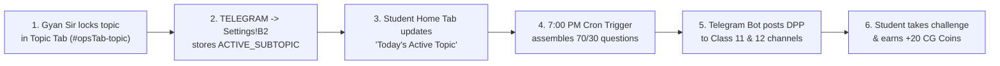
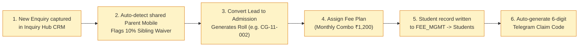
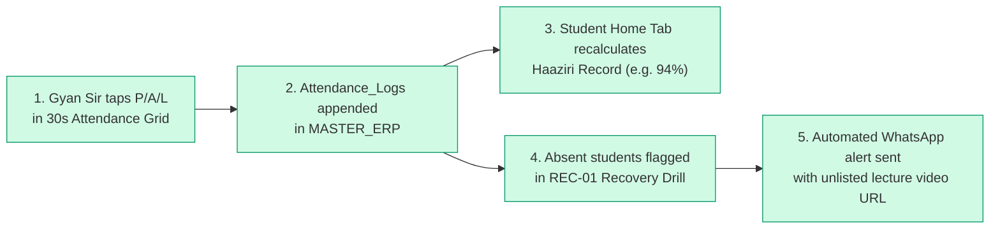

# COMMERCE GYAN MASTER APP — FUNCTIONALITY & COMPONENT DEPENDENCY MAP

> **Architecture Depth:** Comprehensive mapping of shared frontend utilities, backend services, cross-module workflows, and legacy/disconnected components.  
> **Source Verification:** Extracted directly through code inspection of `index.html`, `frontend/js/*.js`, and `backend/*.gs`.

---

## 1. Shared Frontend Utility Infrastructure (`index.html`)

The entire client application relies on a shared set of high-performance utility functions exposed on the `window` scope:

```mermaid
graph TD
    classDef util fill:#E0E7FF,stroke:#4338CA,stroke-width:2px,color:#1E1B4B;
    classDef consumer fill:#FEF3C7,stroke:#D97706,stroke-width:1px,color:#78350F;

    U_CALL["window.cgCallGas(action, payload)<br/><i>Unified GAS API caller with timeout & error handling</i>"]:::util
    U_TOAST["window.showToast(msg, type)<br/><i>Non-intrusive floating notification pill</i>"]:::util
    U_ESC["window.escHtml(str)<br/><i>XSS sanitizer for dynamic HTML injection</i>"]:::util
    U_CLS["window.resolveActiveStudentClass()<br/><i>Resolves '11' or '12' from active session</i>"]:::util
    U_RUNNER["window.launchMcqRunner(config)<br/><i>Launches 4-Option Ghost Speed Runner</i>"]:::util
    U_DETAIL["window.stuShowDetail(title, html)<br/><i>Unified modal popup (#stuDetailModal)</i>"]:::util

    U_CALL --> C_HOME["Home Tab (Bootstrap & Notices)"]:::consumer
    U_CALL --> C_PAD["Padhai Tab (Practice & Syllabus)"]:::consumer
    U_CALL --> C_DOUBT["Doubt Tab (Gemini AI & Voice)"]:::consumer
    U_CALL --> C_FEES["Fees Tab (Passbook & UTR Intimations)"]:::consumer
    U_CALL --> C_OPS["Teacher Daily Ops (Topic Lock & Attendance)"]:::consumer

    U_CLS --> C_CH["Choose Chapters Modal (4-Subject Filtering)"]:::consumer
    U_CLS --> C_ROAD["CBSE Curriculum Roadmap (Class 11 Isolation)"]:::consumer
    U_CLS --> C_MCQ["Daily MCQ Dispatcher"]:::consumer

    U_RUNNER --> C_DAILY["Daily MCQ Card"]:::consumer
    U_RUNNER --> C_PRACTICE["Chapter Practice Launcher"]:::consumer
```



### Detailed Utility Catalog
1. **`window.cgCallGas(action, payload)` (`index.html:4100`):**
   * Wraps `fetch()` to the Google Apps Script WebApp endpoint (`AKfycbxz...`).
   * Handles client timeout (extended to 45,000ms to allow Gemini AI generation) with automatic fallback handling.
   * Injects Telegram WebApp authentication headers (`tgInitData`).
2. **`window.resolveActiveStudentClass()` (`index.html:9805`):**
   * Inspects `window.viewAsStudentRollNo`, `window.cgActiveStudent`, or the `#tgStudentSelect` value.
   * Evaluates regex patterns (`-(11|12)\b` or `Class (11|12)`) and returns `'11'` or `'12'` without guessing.
3. **`window.launchMcqRunner(config)` (`index.html:3160`):**
   * Reusable full-screen examination overlay controller.
   * Consumes `{ title, badge, mode: 'daily'|'practice', subject, questions }`.
   * Manages Ghost Timer countdown, option shuffling, score aggregation, and coin awards.
4. **`window.stuShowDetail(title, html)` (`index.html:6080`):**
   * Reusable responsive popup modal (`#stuDetailModal`).
   * Displays timetable slot details, academic notice bulletins, and metric breakdowns.

---

## 2. Shared Backend Core Services (`backend/*.gs`)

```mermaid
graph TD
    classDef svc fill:#D1FAE5,stroke:#059669,stroke-width:2px,color:#064E3B;
    classDef handler fill:#FFEDD5,stroke:#EA580C,stroke-width:1px,color:#7C2D12;

    S_LOCK["withWriteLock_(fn)<br/><i>LockService 30s mutex for atomic Sheet writes</i>"]:::svc
    S_STU["getVerifiedStudentClass_(user)<br/><i>Authoritative Class 11/12 server resolution</i>"]:::svc
    S_ADMIN["requireAdmin_(userId)<br/><i>Admin authorization gatekeeper</i>"]:::svc
    S_CACHE["CacheService & Topic Sharding<br/><i>Pre-warmed memory cache (<100KB chunks)</i>"]:::svc
    S_SHEET["sheetToObjects(sheet)<br/><i>High-speed 2D grid to JSON object mapper</i>"]:::svc

    S_LOCK --> H_ATT["saveAttendanceBatch"]:::handler
    S_LOCK --> H_FEE["recordFeePayment / recordPaymentIntimation"]:::handler
    S_LOCK --> H_DPP["dispatchDailyDPPAndSubjectivePDF"]:::handler
    S_LOCK --> H_NOTICE["saveNotice / deleteNotice"]:::handler

    S_STU --> H_Q["apiGetDailyQuestion_"]:::handler
    S_STU --> H_PRACTICE["handleGetPracticeQuestions_"]:::handler
    S_STU --> H_REC["getClassRecordingLink"]:::handler

    S_ADMIN --> H_CURR["apiGetCurriculum_"]:::handler
    S_ADMIN --> H_SETTOPIC["setActiveSubtopic_"]:::handler
```



### Detailed Service Catalog
1. **`withWriteLock_(fn)` (`backend/Code.gs:115`):**
   * Wraps critical sheet mutations inside `LockService.getScriptLock()`.
   * Acquires a 30-second lock, executes the callback function, and releases the lock in a `finally` block to prevent deadlock.
2. **`getVerifiedStudentClass_(verifiedUser)` (`backend/questions.gs:115`):**
   * **Security Rule:** Ignores any class parameter sent by the browser. Queries `SHEET_FEE -> Students -> Class` on the server.
   * Throws explicit Hindi error: `"CLASS_MISSING: Students sheet me aapki Class (11 ya 12) likhi nahi hai. Gyan Sir se contact kijiye."` if missing.
3. **`requireAdmin_(userId)` (`backend/auth.gs:45`):**
   * Validates if the requesting Telegram User ID matches Gyan Sir (`552858970`) or configured admin IDs in `PropertiesService`.
4. **`CacheService` Topic Sharding (`backend/questions.gs:2100`):**
   * Shards questions by topic key (`CG_QUESTIONS_${subtopicId}`) to stay strictly within Google's 100KB per-item cache limit.

---

## 3. Cross-Module Critical Workflows

### Workflow A: Pre-Class Topic Lock -> Student Today Tab -> Nightly DPP Dispatch


### Workflow B: Admissions Inquiry -> Sibling Match -> Directory Enrolment -> Fee Plan


### Workflow C: 30-Second Classroom Attendance -> Haaziri % -> REC-01 Absence Recovery


---

## 4. Potentially Disconnected, Unused & Legacy Components (Architectural Audit)

During the deep codebase inspection, the following historical relics, duplicate tabs, and retired systems were cataloged to maintain complete transparency:

### 1. `Students_Master` (`MASTER_ERP`) vs `Students` (`FEE_MGMT`)
* **Finding:** Historically, student records were stored in `MASTER_ERP -> Students_Master`. When the dedicated `3. Fee Management` spreadsheet was established, a new `Students` tab was created.
* **Current Status:** The backend now strictly utilizes `FEE_MGMT -> Students` as the single source of truth for student enrolment, class level, contact info, and fee calculations. `Students_Master` in `MASTER_ERP` is maintained as a read-only mirror.
* **Action:** Kept intact for historical data safety; never modified directly.

### 2. Retired Cash Drawer & Balance Sheet Audit
* **Code Reference:** `backend/Code.gs:2830`:
  ```javascript
  function checkBalanceSheetIntegrity() {
    return {
      ok: false,
      retired: true,
      message: "Cash Drawer & Balance Sheet Audit system retired. Direct expenses belong in Center Management."
    };
  }
  ```
* **Finding:** Center commercial bookkeeping was separated into `5. Books & Expenses` (`frontend/admin/books.html`), retiring legacy in-app balance sheet audit endpoints.

### 3. Misplaced SWOT Receipt Button in Batch Lectures (Recently Fixed)
* **Finding:** In earlier versions, a `<button id="tgOpenReceiptBtn">SWOT Receipt</button>` was accidentally placed inside the "Today's Batch Lectures" container on the student Home tab.
* **Current Status:** Removed and relocated exclusively to the Fees tab (`#tgTab-fees`), where it belongs logically alongside tuition payment passbooks.

### 4. Practice Question Bank Fallback (`window.PRACTICE_QUESTION_BANK`)
* **Finding:** `index.html:7378` contains a static JavaScript object of CBSE questions across Accountancy, BST, Economics, and Statistics.
* **Current Status:** This is an intentional **offline resilience mechanism**. When students open practice quizzes in poor connectivity environments (or during Google Apps Script cold starts), the application seamlessly falls back to this local question bank so the student experience never freezes. When network connectivity is active, live questions are pulled directly from Google Sheets (`QUESTION_BANK` / `Master Question Repo`).
