# COMMERCE GYAN MASTER APP — COMPLETE SYSTEM ARCHITECTURE & OVERVIEW

> **Document Version:** 2.5 (Production Audited)  
> **Target Audience:** Founder (Gyan Sir), Senior Engineers, Academic Operations, Non-Technical Staff  
> **Status:** Fully Live on Google Apps Script (Deployment `@161`), Telegram Mini App (`CGHELP`), and Google Sheets Ecosystem.

---

## 1. Executive Summary & Purpose

The **Commerce Gyan Master App** (known to students as **CGHELP**) is a specialized enterprise EdTech Operating System designed for offline and hybrid coaching institutes preparing Class 11 and Class 12 CBSE/State Board students in Commerce (**Accountancy, Business Studies, Economics, and Statistics**).

Unlike generic LMS platforms, this platform unites **5 distinct operational dimensions** into a single, cohesive engine:
1. **Student Telegram Mini App (`CGHELP`):** A frictionless, login-free mobile web application accessed directly through Telegram WebApp, providing daily practice (DPP), curriculum roadmaps, AI mentor doubt resolution, performance tracking, and fee records.
2. **Teacher Command Center & Daily Ops Workspace:** An operational cockpit enabling Gyan Sir to lock daily topics, take 30-second attendance, log lesson plans, upload GoodNotes chalkboard PDFs, and dispatch nightly DPPs with a single click.
3. **Automated AI Question Bank & Examination Engine:** A 20-column curriculum-aligned question vault powered by Gemini AI with real-time NCERT rubrics, step marking, trap alerts, and real-world Shark Tank business hints.
4. **Red-Pen Subjective Copy Checking:** A vision-assisted grading pipeline where students upload photos of their handwritten register solutions, analyzed against CBSE 5-step marking rubrics.
5. **Double-Entry Tuition Fee & SWOT Intelligence:** A financial ledger calculating monthly/quarterly fees, promise discounts, penalty waiving, dynamic UPI QR generation, and automated SWOT Smart Receipts.

---

## 2. High-Level System Architecture

```mermaid
graph TD
    %% Base styling
    classDef client fill:#E0E7FF,stroke:#4338CA,stroke-width:2px,color:#1E1B4B;
    classDef backend fill:#FEF3C7,stroke:#D97706,stroke-width:2px,color:#78350F;
    classDef sheets fill:#D1FAE5,stroke:#059669,stroke-width:2px,color:#064E3B;
    classDef ai fill:#FCE7F3,stroke:#DB2777,stroke-width:2px,color:#831843;
    classDef external fill:#F3F4F6,stroke:#4B5563,stroke-width:2px,color:#111827;

    subgraph CLIENT_LAYER ["Frontend Clients (Browser / Telegram)"]
        STU["Student Telegram Mini App (CGHELP)<br/><i>index.html (Home, Padhai, Doubt, Progress, Fees)</i>"]:::client
        TEA_OPS["Teacher Daily Ops Workspace<br/><i>Aaj, Topic, Start, End, DPP, More</i>"]:::client
        TEA_ERP["Teacher ERP Command Center<br/><i>Dashboard, Timetable, Admissions, Fees, Sync</i>"]:::client
        STUDIO["Studio Controller<br/><i>studio/index.html & bridge.js</i>"]:::client
        BOOKS["Books & Inventory Manager<br/><i>frontend/admin/books.html</i>"]:::client
    end

    subgraph BACKEND_LAYER ["Google Apps Script Backend (Serverless)"]
        ROUTER["API Router & Security Gate<br/><i>backend/Code.gs (doGet / doPost)</i>"]:::backend
        AUTH_SVC["Auth & Identity Service<br/><i>backend/auth.gs (Telegram HMAC-SHA256)</i>"]:::backend
        DPP_SVC["DPP & Question Engine<br/><i>backend/questions.gs & dpp_decider.gs</i>"]:::backend
        FEE_SVC["Fee & Ledger Service<br/><i>backend/fees.gs & daily_control.gs</i>"]:::backend
        REDPEN_SVC["Red-Pen Vision Checker<br/><i>backend/redpen.gs</i>"]:::backend
        DOUBT_SVC["Doubt AI Assistant<br/><i>backend/doubts.gs</i>"]:::backend
        TRIGGERS["Automated Triggers<br/><i>backend/triggers.gs (7 PM DPP, Reminders)</i>"]:::backend
    end

    subgraph AI_SERVICES ["External AI & Telephony Engines"]
        GEMINI["Google Gemini 2.5 Flash API<br/><i>Doubt Resolution & Red-Pen OCR</i>"]:::ai
        TG_BOT["Telegram Bot API (@CommerceGyanBot)<br/><i>Broadcasts, Alerts, WebApp Entry</i>"]:::external
        DRIVE["Google Drive API<br/><i>PDFs, Handwritten Copies, Class Recordings</i>"]:::external
    end

    subgraph DATABASE_LAYER ["Google Sheets Relational Ecosystem (7 Spreadsheets)"]
        S_ERP["1. Master ERP<br/><i>Timetable, Notices, Batches, Claims</i>"]:::sheets
        S_SYL["2. Syllabus Planner<br/><i>797 CBSE Subtopics, Roadmap</i>"]:::sheets
        S_QB["3. Question Bank<br/><i>DailyQuestions, StudentAnswers, Doubts</i>"]:::sheets
        S_FEE["4. Fee Management<br/><i>Students, Payments, Plans, Receipts</i>"]:::sheets
        S_TG["5. Telegram Delivery<br/><i>Settings, Logs, Broadcasts</i>"]:::sheets
        S_BOOKS["6. Books & Expenses<br/><i>Center Inventory, Balance Sheet</i>"]:::sheets
        S_REPO["7. Master Question Repo<br/><i>8 Subject Vaults, 20-Col Schema</i>"]:::sheets
    end

    %% Client to Backend
    STU -->|HTTPS POST window.cgCallGas| ROUTER
    TEA_OPS -->|HTTPS POST window.cgCallGas| ROUTER
    TEA_ERP -->|HTTPS POST window.cgCallGas| ROUTER
    STUDIO -->|HTTPS POST bridge.js| ROUTER
    BOOKS -->|HTTPS POST admin-books.js| ROUTER

    %% Backend Routing
    ROUTER --> AUTH_SVC
    AUTH_SVC --> DPP_SVC
    AUTH_SVC --> FEE_SVC
    AUTH_SVC --> REDPEN_SVC
    AUTH_SVC --> DOUBT_SVC

    %% Backend to External
    DOUBT_SVC --> GEMINI
    REDPEN_SVC --> GEMINI
    DPP_SVC --> TG_BOT
    TRIGGERS --> TG_BOT
    REDPEN_SVC --> DRIVE
    ROUTER --> DRIVE

    %% Backend to Database
    AUTH_SVC --> S_ERP
    DPP_SVC --> S_SYL
    DPP_SVC --> S_QB
    DPP_SVC --> S_REPO
    FEE_SVC --> S_FEE
    FEE_SVC --> S_ERP
    ROUTER --> S_TG
    ROUTER --> S_BOOKS
```

---

## 3. The Five Major Subsystems

### Subsystem 1: Student Telegram Mini App (`CGHELP`)
* **Deployment Mode:** Runs seamlessly inside the Telegram native mobile client via WebApp iframe (`initDataUnsafe`), or standalone in any mobile browser with mock testing headers.
* **Core Navigation:** 5 persistent bottom tabs:
  1. **Home (`#tgTab-home`):** Daily dashboard, active class topics, fees snapshot, haaziri percentage, active notices, and Daily MCQ Speed Challenge.
  2. **Padhai (`#tgTab-syllabus`):** CBSE Curriculum Roadmap (Subject -> Chapter -> Topic -> Subtopic tree), Chapter Practice selector, offline GoodNotes chalkboard PDFs, and YouTube lecture shortcuts.
  3. **Doubt (`#tgTab-doubt`):** Gyan Sir 24/7 AI Mentor with 4 subject chips, prompt shortcuts, text chat stream, and voice query recording.
  4. **Progress (`#tgTab-progress`):** CBSE 80/80 Target Progress Scorecard, Chapter Mastery breakdown, Red-Pen copy history, and Batch Leaderboard with CG Coins.
  5. **Fees (`#tgTab-fees`):** Fee profile, installment status, passbook history, SWOT smart receipts, UTR payment intimation form, and dynamic UPI QR code generator.

### Subsystem 2: Teacher ERP & Command Cockpit
* **Dual Interface Design:**
  * **Teacher Daily Ops Workspace (`#teacherOpsWorkspace`):** Optimized for smartphone/iPad use during class hours with 6 fast tabs: `Aaj` (Daily checklist), `Topic` (Lock active topic), `Start` (Begin session), `End` (Conclude session & upload PDF), `DPP` (7 PM manual trigger), and `More` (Settings & switches).
  * **Teacher Desktop Command Center (`#teacherOpsOverlay`):** Full-screen multi-module ERP featuring 5 desktop tabs:
    1. *Today & Timetable:* Command dashboard, weekly routine builder, academic leave calendar.
    2. *Students & Admissions:* Inquiry CRM, 3-day demo pipeline, student directory, parent call log.
    3. *Classroom & Attendance:* 30-second attendance grid, REC-01 absence recovery drill, gradebook analytics.
    4. *Fees & Finance:* Dynamic fee ledger, overdue defaulters tracker, printable SWOT receipt engine.
    5. *Content, DPP & System:* Syllabus planner, question bank auditor, review vault, cloud backup archives.

### Subsystem 3: Google Apps Script Backend (Serverless Microservice)
* **Core Dispatcher:** `backend/Code.gs` handles both `doGet` (bootstrapping, health checks, read-only queries) and `doPost` (authenticated mutations, write-locked operations).
* **Write-Lock Concurrency (`withWriteLock_`):** Uses Google Apps Script `LockService.getScriptLock()` with a 30-second timeout to prevent race conditions during simultaneous student test submissions or fee writes.
* **Topic-Sharded Caching:** Leverages `CacheService.getScriptCache()` to cache active syllabus trees, daily question packages, and leaderboard metrics for up to 6 hours (<100KB safe chunks).

### Subsystem 4: Google Sheets Relational Database
The entire application operates without SQL databases (PostgreSQL/MySQL) or MongoDB. Instead, it utilizes **7 linked Google Spreadsheets** structured into **94 specialized tabs** acting as a relational database:
1. `MASTER_ERP` (`1Muw7P...`): 43 tabs managing timetable, admissions, claim codes, attendance, notices, and system configuration.
2. `SYLLABUS` (`1-LrOh...`): 3 tabs storing 797 CBSE subtopics, chapter weightages, and board taxonomies.
3. `QUESTION_BANK` (`1VI89c...`): 12 tabs storing active MCQs, daily dispatches, live student answers, doubts, and mysteries.
4. `FEE_MGMT` (`1Dka1y...`): 7 tabs storing student fee plans, installment schedules, transactions, and discount promises.
5. `TELEGRAM` (`1Kslov...`): 12 tabs managing bot webhooks, broadcast logs, daily class notes, and trigger states.
6. `BOOKS_EXPENSES` (`15bM32...`): 6 tabs managing physical textbook stock, direct coaching expenses, and balance sheets.
7. `MASTER_Q_REPO` (`1FMk5K...`): 11 tabs acting as the cold-storage vault across 8 academic subjects with a 20-column schema.

### Subsystem 5: Specialized Companion Apps
* **Books & Inventory Manager (`frontend/admin/books.html`):** Standalone interface for tracking study material dispatch, TS Grewal / Sandeep Garg books inventory, and cash drawer reconciliations.
* **Studio Controller (`studio/index.html`):** Hardware controller linked to the classroom Mac mini for automated class recording uploads to Google Drive.

---

## 4. Key Security & Privacy Safeguards
1. **Server-Side Identity Verification:** The student's Class level (`11` or `12`) is strictly derived from the verified student database record (`SHEET_FEE > Students > Class`). Browser-supplied class parameters are discarded to prevent cross-batch cheating.
2. **Fisher-Yates Option Shuffling:** To eliminate answer sharing in physical classrooms, options A, B, C, D are randomized per student session with an internal cryptographic mapping dictionary (`optionMap`).
3. **Minor Data Protection:** No student personally identifiable information (PII) is shared with public third-party services. AI prompts are sanitized before being sent to Gemini API endpoints.
4. **Environment Isolation (`ENV_MODE`):** The system features a single-switch toggling mechanism between `PRODUCTION` and `STAGING` sheets via `PropertiesService`.
