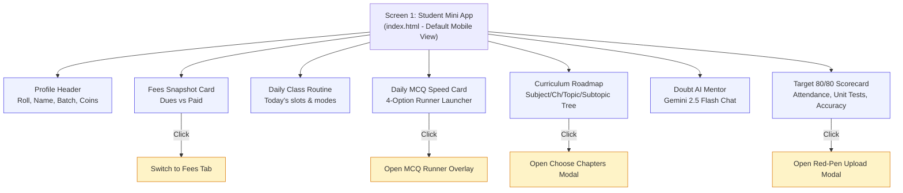
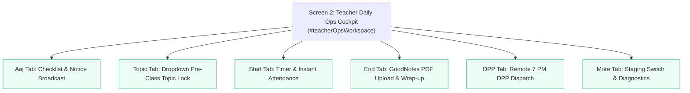
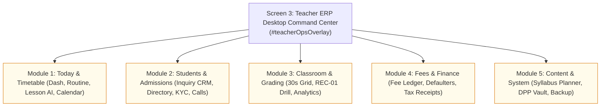

# COMMERCE GYAN MASTER APP — SCREEN-BY-SCREEN ARCHITECTURAL SPECIFICATION

> **Scope:** Complete analysis of every screen, overlay, and standalone web page across the codebase.  
> **Source Verification:** Strictly verified from `index.html`, `frontend/admin/books.html`, `studio/index.html`, and `privacy.html`.

---

## Screen 1: Student Telegram Mini App ("CGHELP")

### 1. Purpose & Problem Solved
* **Purpose:** Provides commerce students (Class 11 & 12) with an ultra-lightweight, zero-friction learning companion directly within Telegram.
* **Problem Solved:** Eliminates app store download resistance, forgotten passwords, clunky LMS menus, and disconnected WhatsApp study groups. Consolidates attendance, notices, lecture notes, daily tests, AI doubt resolution, and fee passbooks into a single screen.

### 2. Displayed Information
* Student identity: Full Name, Roll No (e.g., `CG-11-001`), Batch (`Class 11 · CBSE`), earned CG Coins, Haaziri (attendance) percentage.
* Real-time financial dues: Pending balance, total fees paid, and installment due date.
* Today’s timetable slots with subject, scheduled time, lesson topic, and delivery mode (`🏢 Offline`, `📱 CG App`, `🔴 YouTube`).
* Teacher bulletins, class test announcements, and holiday dates.
* Today's active topic locked by Gyan Sir for the 7:30 PM DPP.
* 3-level interactive CBSE curriculum roadmap with learning completion status.
* 80/80 Board preparation score, chapter mastery heatmap, and peer leaderboard.

### 3. User Actions
* Switch between 5 bottom tabs: `Home`, `Padhai`, `Doubt`, `Progress`, `Fees`.
* Launch the Full-Screen 4-Option Daily MCQ & Speed Challenge.
* Expand syllabus chapters and subtopics to watch YouTube video lectures or open GoodNotes chalkboard PDFs.
* Ask doubts via text chat or record voice audio questions to Gyan Sir AI.
* Upload register photos for CBSE Red-Pen grading.
* Generate a dynamic UPI payment QR code or submit a UTR payment intimation.

### 4. Frontend Components
* Sticky preview header: `#viewAsStudentBanner`
* Bottom navigation bar: `.tg-bottom-nav`
* Daily MCQ card: `.stu-open-daily-mcq-btn`
* Curriculum accordion container: `#stuSyllabusTreeContainer`
* AI doubt chat feed: `#stuDoubtChatStream`
* CBSE 80/80 Target Scorecard: `#stuTargetRadarCard`
* Dynamic UPI QR trigger: `#payTuitionUpiBtn`

### 5. Backend APIs & Data Sources
* `getStudentMiniAppBootstrap`: Fetches student profile, enrolled subjects, and fee plan from `FEE_MGMT -> Students`.
* `getWeeklyTimetable`: Fetches Mon–Sat routine slots from `MASTER_ERP -> Weekly_Timetable`.
* `getNotices`: Fetches active announcements from `MASTER_ERP -> Notices`.
* `getSyllabusTree`: Fetches 797 CBSE subtopics from `SYLLABUS -> Master_Syllabus`.
* `getDailyQuestion`: Fetches active DPP package from `QUESTION_BANK -> DailyQuestions` / `Master Repo`.

### 6. Connected Screens
* Connected directly to Overlays 4, 5, 6, 7, and 8 via user action modals.

---

## Screen 2: Teacher Daily Ops Mobile Cockpit

### 1. Purpose & Problem Solved
* **Purpose:** A mobile-first, high-speed administrative interface designed for Gyan Sir to manage daily classroom operations directly from a smartphone or iPad during teaching hours.
* **Problem Solved:** Prevents teachers from getting bogged down in complex desktop ERP menus while standing in front of a smartboard. Reduces class management to simple 1-tap buttons.

### 2. Displayed Information
* Real-time operational status (Active Session ID, running timer, class mode).
* Dropdown list of NCERT chapters and subtopics for Class 11 and Class 12.
* Roster of enrolled students for the active batch.
* Nightly 7 PM DPP status (fresh focus vs retention counts).
* Production vs Staging environment status.

### 3. User Actions
* **Post Notice:** Send instantaneous alerts to Class 11, Class 12, or All batches.
* **Lock Active Topic:** Sets tonight's test topic in Timetable and Telegram settings.
* **Start Session:** Starts lesson stopwatch, records session ID, logs start timestamp.
* **Mark Attendance:** 1-tap toggling of student attendance.
* **End Session:** Stops session, pastes Google Drive URL of GoodNotes chalkboard PDF, updates lesson progress.
* **Remote DPP Dispatch:** Dispatches 70/30 pacing package to Telegram channels before 7 PM.

### 4. Frontend Components
* Quick tabs bar: `.ops-tab-btn` (`#opsTab-aaj`, `#opsTab-topic`, `#opsTab-start`, `#opsTab-end`, `#opsTab-dpp`, `#opsTab-more`)
* Notice composer form: `#quickNoticeTitle`, `#quickNoticeBody`, `#quickNoticeBatch`
* Active topic dropdown: `#lockTopicSelect`, `#opsLockTopicBtn`
* End class PDF input: `#endClassGoodnotesInput`, `#btnEndClass`
* Remote command buttons: `.bot-cmd-btn`

### 5. Backend APIs & Data Sources
* `saveNotice` -> `MASTER_ERP -> Notices`
* `setActiveSubtopic` -> `TELEGRAM -> Settings!B2` & `MASTER_ERP -> Weekly_Timetable`
* `startClassSession` -> `MASTER_ERP -> Class_Sessions`
* `endClassSession` -> `MASTER_ERP -> Daily_Class_Recordings`
* `dispatchDailyDPPAndSubjectivePDF` -> Telegram Bot API & `QUESTION_BANK -> DailyQuestions`

---

## Screen 3: Teacher ERP Desktop Command Center

### 1. Purpose & Problem Solved
* **Purpose:** A complete, enterprise-grade coaching institute management suite designed for office desktop use, administrative staff, and deep academic planning.
* **Problem Solved:** Replaces fragmented spreadsheets, paper registers, physical receipt books, manual fee calculation notebooks, and disparate CRM software with one unified system.

### 2. Displayed Information
* Overall institute health: Active students, total monthly revenue, collection rate, pending dues.
* Weekly timetable matrix (Mon–Sat, 7 AM to 8 PM) with subject, batch, room, and delivery mode.
* Admissions pipeline: Lead stages (New Enquiry, Demo 1, Demo 2, Demo 3, Admission Quote, Enrolled).
* Sibling discount linkage alerts (detects shared parent mobile numbers).
* 30-second attendance grid with historical haaziri percentages.
* Overdue fee defaulters categorized by days late (3 days, 7 days, 15+ days).
* Complete 797 CBSE syllabus topics with delivery medium and completion timestamps.

### 3. User Actions
* Add, edit, or reschedule timetable slots with specified delivery modes (`Offline`, `CG App`, `YouTube`).
* Generate AI-assisted lesson plans aligned with NCERT learning objectives.
* Progress student leads across CRM stages or convert them to enrolled students.
* Record tuition fee payments with auto-calculated discounts, coin redemptions, and late fees.
* Generate and print official GST/PAN compliant SWOT receipts.
* Create full JSON cloud backup archives of all 7 Google Sheets.

### 4. Frontend Components
* Main navigation sidebar: `.nav-tab-btn`
* Top module tabs: `#tab-dashboard`, `#tab-pipeline`, `#tab-attendance`, `#tab-erp_fees`, `#tab-curriculum`
* 30-second attendance table: `#attendanceBatchTbody`
* Lead conversion modal: `#leadConversionModal`
* Fee payment recording modal: `#recordPaymentModal`
* Timetable slot addition card: `#addSlotFormCard`

### 5. Backend APIs & Data Sources
* Reads/writes across all 7 Google Spreadsheets (`MASTER_ERP`, `SYLLABUS`, `QUESTION_BANK`, `FEE_MGMT`, `TELEGRAM`, `BOOKS_EXPENSES`, `MASTER_Q_REPO`).

---

## Screen 4: Full-Screen 4-Option MCQ & Speed Challenge Runner

* **Container ID:** `#stuMcqRunnerOverlay`
* **Purpose:** Provides a high-focus, distraction-free examination screen for daily DPPs, chapter-wise drills, and speed challenges.
* **Problem Solved:** Prevents student guessing, eliminates peer answer copying via randomized option shuffling, and trains students for board exam time management through a "Ghost Timer".
* **Displayed Information:**
  * Test title (e.g., *"Today's DPP"* or *"Accountancy Chapter 5 Practice"*).
  * Question index counter (e.g., `Question 2 of 5`).
  * Dynamic Ghost Timer countdown bar (30–45 seconds per question).
  * Formatted question text with KaTeX rendered math/accounting formulas.
  * 4 option cards (A, B, C, D) with distinct hover/selected states.
  * Post-submission instant feedback: Correct/Incorrect status, official NCERT explanation, step marking rubric, and Shark Tank real-world hint.
* **Actions:** Select option, submit answer, view explanation, proceed to next question, view final score card with coin rewards (+20 CG coins).
* **Backend Trigger:** `submitStudentQuizAttempt` -> logs to `QUESTION_BANK -> StudentAnswers` and awards coins in `MASTER_ERP -> Coin_Ledger`.

---

## Screen 5: Student Red-Pen Copy Checking Modal

* **Container ID:** `#stuRedPenModal`
* **Purpose:** Mobile upload interface for students to submit photos of their handwritten register solutions.
* **Problem Solved:** Bridges the gap between objective online MCQs and mandatory board exam subjective answer writing practice.
* **Displayed Information:**
  * Submission instructions: Guidelines for capturing clear photos of handwritten calculations, journal entries, and balance sheets.
  * Subject selector dropdown (Accountancy, BST, Economics, Statistics).
  * Selected image file preview.
  * Status indicator: `Uploading to Drive...`, `Analyzing with Red-Pen AI...`, `Ready for Review`.
* **Actions:** Take photo or upload image, select subject, add optional note for Gyan Sir, submit for analysis.
* **Backend Trigger:** `submitRedPenCopy` -> Uploads image to Google Drive, calls Gemini 2.5 Flash for step-marking audit, logs record in `QUESTION_BANK -> Student_Red_Pen`.

---

## Screen 6: Choose Chapters Practice Modal

* **Container ID:** `#stuChooseChaptersModal`
* **Purpose:** Enables students to customize their self-paced practice by selecting specific syllabus chapters.
* **Problem Solved:** Allows students preparing for upcoming school unit tests or revision exams to drill specific chapters rather than the entire annual syllabus.
* **Displayed Information:**
  * Subject selection chips: **Accounts**, **BST**, **Economics**, and **Statistics** (Class 11).
  * Complete list of NCERT chapters for the chosen subject (all 11 for Accounts, 10 for BST, etc.).
  * Real-time question availability count per chapter.
  * Selected chapter count badge (e.g., `3 Selected`).
* **Actions:** Switch subjects, toggle chapter checkboxes, click "Start Practice" to launch customized MCQ runner.
* **Connected Components:** Filters questions from `window.PRACTICE_QUESTION_BANK` and launches Screen 4 (`#stuMcqRunnerOverlay`).

---

## Screen 7: SWOT Smart Receipt & Academic Performance Modal

* **Container ID:** `#swotModalOverlay`
* **Purpose:** Combines official tuition fee payment vouchers with holistic academic performance analytics into a single printable report.
* **Problem Solved:** Solves parent transparency issues. When parents pay fees, they receive not just a financial receipt, but a complete SWOT analysis (Strengths, Weaknesses, Attendance, DPP Habit) of their child.
* **Displayed Information:**
  * Official Institute Header: Commerce Gyan Begusarai, GST/PAN references, voucher number.
  * Student details: Name, Roll, Batch, Enrolled Subjects, Date of Admission.
  * Payment summary: Base fee, sibling discount, coin deductions, penalty waivers, net paid amount.
  * Academic SWOT Matrix: Attendance percentage, DPP streak, mock test scores, strongest chapter, leak area topic.
  * Gyan Sir's personalized teacher note.
* **Actions:** Close modal, Print/Save as PDF (`window.print()`), configure visible SWOT fields (Teacher mode).
* **Backend Trigger:** `getSwotConfig`, `saveSwotConfig` -> `MASTER_ERP -> SWOT_Config`.

---

## Screen 8: Dynamic Tuition UPI QR Modal

* **Container ID:** `#upiQrModal`
* **Purpose:** Displays an instantly scannable, pre-configured UPI QR code for tuition fee payments.
* **Problem Solved:** Eliminates payment errors where parents type wrong bank account numbers or pay incorrect dues amounts.
* **Displayed Information:**
  * Official UPI VPA (`commercegyan@okaxis` / `9835011201@upi`).
  * Student Name and Roll Number.
  * Exact pending balance in Rupees (e.g., `₹1,200`).
  * Scannable QR code generated via Google Charts Infographics API (`cht=qr`).
* **Actions:** Scan QR code with PhonePe / Google Pay / Paytm, copy UPI ID, click "Payment ki jaankari bhejo" to submit UTR reference.

---

## Screen 9: Center Books & Inventory Manager (`frontend/admin/books.html`)

* **Path:** `frontend/admin/books.html` & `frontend/js/admin-books.js`
* **Purpose:** Standalone back-office portal for managing commercial textbooks and coaching study material inventory.
* **Problem Solved:** Tracks physical books purchased from publishers and distributed to students, preventing textbook inventory leakage and cash discrepancies.
* **Displayed Information:**
  * Current stock levels for standard textbooks (TS Grewal Class 11/12, Sandeep Garg Economics, Poonam Gandhi BST).
  * Supplier invoices, purchase dates, unit costs, and distributor balances.
  * Student textbook dispatch logs.
* **Actions:** Add new book purchase, record student book sale, adjust physical inventory count, reconcile daily book sales cash drawer.
* **Backend Trigger:** Reads/writes to `BOOKS_EXPENSES -> Expenses, Assets, Liabilities`.

---

## Screen 10: Classroom Studio Controller (`studio/index.html`)

* **Path:** `studio/index.html` & `studio/bridge.js`
* **Purpose:** Specialized hardware and software bridge connecting the physical coaching smartboard/Mac mini to the cloud ERP.
* **Problem Solved:** Automates class session recording, chalkboard PDF generation, and student lecture delivery without manual video rendering steps.
* **Displayed Information:**
  * Active lecture session metadata (Subject, Chapter, Topic, Start Time, Frame Rate).
  * Video recording status (Recording, Paused, Encoding, Uploaded).
  * Cloud sync status: Google Drive destination folder, YouTube Unlisted upload status.
* **Actions:** Start Recording, Pause Recording, Export GoodNotes Chalkboard PDF, Generate Student Access Link.
* **Backend Trigger:** `uploadDailyClassNotes`, `registerClassNoteFile` -> `MASTER_ERP -> Daily_Class_Recordings`.

---

## Screen 11: Privacy Policy & Legal Terms (`privacy.html`)

* **Path:** `privacy.html`
* **Purpose:** Public-facing compliance document required by Telegram WebApp and Google OAuth policies.
* **Problem Solved:** Ensures strict compliance with Telegram Bot API guidelines, Google API Services User Data Policy, and minor data protection standards.
* **Displayed Information:**
  * Data collected: Student Roll Number, Telegram User ID, Attendance logs, Quiz responses.
  * Explicit confirmation that student academic data of minors is never sold, leased, or transmitted to third-party advertising networks.
  * Clarification of AI integration: Questions submitted to Gemini AI are anonymized and stripped of student names.
