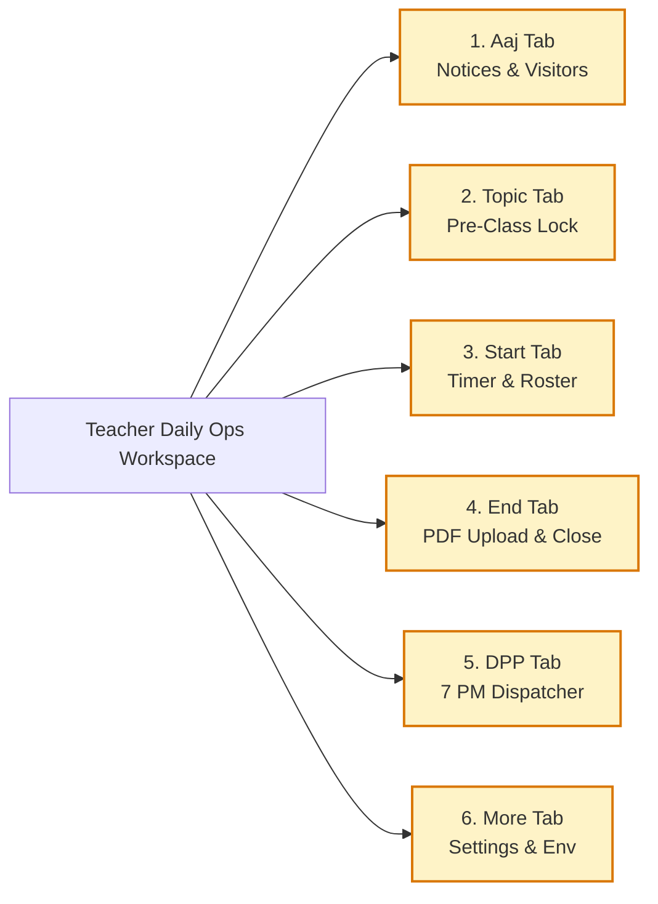

# COMMERCE GYAN MASTER APP — TAB-BY-TAB FUNCTIONAL SPECIFICATION

> **Coverage:** Exhaustive analysis of every tab, subtab, nested menu, and operational view across the entire application.  
> **Source Verification:** Verified directly from DOM element IDs, event listeners, and backend handlers in `index.html` and `backend/*.gs`.

---

## SECTION 1: STUDENT TELEGRAM MINI APP TABS (`CGHELP`)

### Tab 1.1: Home Dashboard Tab (`#tgTab-home`)

* **Purpose:** Serves as the daily launchpad for the student, delivering time-sensitive routine, attendance status, active class topics, and practice challenges.
* **On Open Event:** `switchStudentTab('home')` -> triggers `renderTelegramMiniApp()`, `renderStuToday()`, and `updateTodayPracticeUI()`.
* **Displayed Data:**
  * Student Full Name, Roll Number, Class level badge (`Class 11 · CBSE`), CG Coins, Haaziri percentage.
  * Fee status preview: Total Fee, Amount Paid, Pending Dues.
  * Today's lectures list with start time, subject, and mode badge (`🏢 Offline`, `📱 CG App`, `🔴 YouTube`).
  * Latest active institutional notice with type badge (e.g., `Class Test`, `Holiday`).
  * Class-filtered active subtopic locked by Gyan Sir for tonight's DPP.
  * Daily MCQ & Speed Challenge teaser card with action button.
  * Mon–Sat weekly routine slots with colored mode badges.
* **Buttons & Actions:**
  * `#tgStudentSelect` (Dropdown): Switch active student view for administrative testing.
  * `.stu-open-daily-mcq-btn` (Button): Launches Screen 4 (`#stuMcqRunnerOverlay`).
  * `[data-stu-detail="slot"]` (Card): Opens slot details modal (`#stuDetailModal`) showing Day, Time, Topic, and Mode.
  * `#stuNoticeDetailBtn` (Link): Opens notice popup (`#stuDetailModal`) showing full notice body and dates.
* **Frontend Components Involved:** `#tgStudentNameHeader`, `#stuFeesStatusCard`, `#tgAajKiClassesList`, `#stuWeeklyScheduleBox`, `#tgTodayActiveTopicBox`.
* **Backend APIs Triggered:** `getStudentMiniAppBootstrap`, `getWeeklyTimetable`, `getNotices`.
* **Expected Output:** Dynamic, highly personalized mobile dashboard reflecting real-time class schedule and financial standing.
* **Dependencies:** Depends on `FEE_MGMT -> Students` for roll data and `MASTER_ERP -> Weekly_Timetable` for slots.

---

### Tab 1.2: Padhai & Curriculum Roadmap Tab (`#tgTab-syllabus`)

* **Purpose:** The student's digital textbook, self-paced practice library, and structured CBSE curriculum roadmap.
* **On Open Event:** `switchStudentTab('syllabus')` -> triggers `renderStuSyllabusCards()` and `openStuPracticeSubject(stuDefaultSubject())`.
* **Displayed Data:**
  * Today's DPP status card (Questions count, completion status).
  * 4 Class 11 Subject Selector Cards: **Accountancy**, **Business Studies**, **Economics**, **Statistics** (with total chapter and topic counts).
  * Roadmap summary bar: Total Chapters, Total Topics, Total Subtopics, % Completed.
  * 3-Level Expandable Syllabus Tree:
    * Level 1: Subject (Accountancy, BST, Economics, Statistics).
    * Level 2: Chapter Accordion (`📂 Ch 1 to Ch 11`).
    * Level 3: Topic Accordion (`🔹 Core Concepts & Numerical`).
    * Level 4: Subtopics with individual completion badges (`✓ Completed`, `⏳ In Progress`, `⏳ Upcoming`) and delivery mode (`🏢 Offline`, `📱 CG App`, `🔴 YouTube`).
* **Buttons & Actions:**
  * `#stuOpenChooseChaptersBtn`: Opens Screen 6 (`#stuChooseChaptersModal`) for custom chapter practice.
  * `.stu-practice-subj-btn`: Switches active subject roadmap view.
  * `.stu-watch-video-btn`: Opens YouTube lecture embed or external YouTube app.
  * GoodNotes PDF links: Opens chalkboard lecture notes stored on Google Drive.
  * `#stuStartPracticeQuizBtn`: Launches practice quiz runner for selected chapters.
* **Frontend Components Involved:** `#stuSyllabusSubjectCards`, `#stuSyllabusTreeContainer`, `#stuRoadmapProgressBar`, `#stuPracticeQuestionsBox`.
* **Backend APIs Triggered:** `getSyllabusTree`, `getPracticeQuestions`.
* **Dependencies:** Depends on `SYLLABUS -> Master_Syllabus` (797 CBSE rows) and `QUESTION_BANK -> QuestionBank`.

---

### Tab 1.3: Doubt & AI Mentor Tab (`#tgTab-doubt`)

* **Purpose:** 24/7 personal Commerce AI mentor capable of answering complex accounting, business, and economics queries using NCERT rubrics.
* **On Open Event:** `switchStudentTab('doubt')` -> triggers `renderStuDoubtUi()`, loads conversation history, focuses input.
* **Displayed Data:**
  * AI Mentor status indicator (`Gyan Sir AI is ready`).
  * 4 Subject selector pills (Accounts, BST, Economics, Statistics).
  * Recommended quick prompt chips (e.g., *Hidden Goodwill calculation*, *Fayol vs Taylor principles*, *Overdraft BRS*).
  * Interactive chat stream containing student questions, step-by-step AI answers, and KaTeX accounting formulas.
* **Buttons & Actions:**
  * `.stu-doubt-subj-pill`: Filters prompt chips by subject.
  * `.stu-prompt-chip`: Populates `#stuDoubtInput` with recommended query without auto-sending.
  * `#stuAskDoubtBtn`: Sends text query to Gemini AI.
  * `#stuVoiceDoubtBtn`: Hold-to-record voice query using Web Audio API.
  * `#stuWhatsAppMentorBtn`: Opens WhatsApp to chat with Gyan Sir directly with the question pre-filled.
* **Frontend Components Involved:** `#stuDoubtInput`, `#stuAskDoubtBtn`, `#stuDoubtChatStream`, `#stuDoubtSubjPills`.
* **Backend APIs Triggered:** `askDoubt` / `askDoubtGemini`, `askVoiceDoubt` -> calls Google Gemini 2.5 Flash API and logs to `QUESTION_BANK -> Doubts`.
* **Expected Output:** Instant step-by-step guidance formatted with bullet points, journal entry tables, and NCERT citations.

---

### Tab 1.4: Progress & Leaderboard Tab (`#tgTab-progress`)

* **Purpose:** Provides academic diagnostics, subjective answer check access, and gamified batch rankings.
* **On Open Event:** `switchStudentTab('progress')` -> triggers `renderStudentRadar()`, `renderChapterMasteryHeatmap()`, and `renderLeaderboard()`.
* **Displayed Data:**
  * Red-Pen Copy Checking Card: Compact call-to-action button to submit register photos.
  * CBSE 80/80 Target Scorecard: Predicted board score (e.g. `72/80 · 91% Predicted`) across 4 preparation pillars (Attendance, DPP Habit, Unit Tests, MCQ Accuracy).
  * 3 Key Metric Pills: Overall Accuracy (92%), Strongest Chapter (Partnership), Leak Area (Cash Flow / BRS).
  * Chapter Mastery Breakdown: Class 11 CBSE syllabus progress bars with `Mastered`, `Standard`, or `Leak Alert` tags.
  * Past Checked Copies: Count of graded answer copies with feedback and Drive URLs.
  * Batch Leaderboard: Privacy-masked top 10 stars with avatar, roll, CG Coins, and streak badges.
* **Buttons & Actions:**
  * `#openRedPenBtn`: Opens Screen 5 (`#stuRedPenModal`).
  * `[data-metric-type="accuracy"]`: Opens popup showing subject-wise accuracy breakdown.
  * `[data-metric-type="strongest"]`: Opens popup showing top-scoring chapters.
  * `[data-metric-type="leak"]`: Opens popup showing weakest topics requiring remedial practice.
* **Frontend Components Involved:** `#stuTargetRadarCard`, `#stuMetricChipsRow`, `#stuChapterMasteryList`, `#stuLeaderboardTbody`.
* **Backend APIs Triggered:** `getProgress` -> `QUESTION_BANK -> StudentAnswers`, `Leaderboard`.

---

### Tab 1.5: Tuition Fees & Ledger Tab (`#tgTab-fees`)

* **Purpose:** Transparent financial ledger showing enrolment profile, payment history, official receipts, and UPI payment tools.
* **On Open Event:** `switchStudentTab('fees')` -> triggers `renderStudentFeeLedger()`.
* **Displayed Data:**
  * Tuition Profile Card: Date of Joining, Fee Plan (`Monthly Combo` / `Quarterly`), Base Fee, Current Due, Overdue warning.
  * Passbook Payment Rows: Voucher ID, Payment Date, Mode (UPI/Cash), Penalty paid, Coins redeemed, Net Amount.
  * Pending Payment Intimations: Under-verification UTR submissions.
* **Buttons & Actions:**
  * `#viewSwotReceiptBtn`: Opens Screen 7 (`#swotModalOverlay`) for complete SWOT report.
  * `#openPaymentIntimationBtn`: Toggles `#paymentIntimationCard` form.
  * `#submitPaymentIntimationBtn`: Submits UTR and transaction reference to teacher for verification.
  * `#payTuitionUpiBtn`: Opens Screen 8 (`#upiQrModal`) with dynamic amount QR code.
* **Frontend Components Involved:** `#stuFeeProfileCard`, `#stuPassbookTable`, `#paymentIntimationCard`, `#upiQrModal`.
* **Backend APIs Triggered:** `getStudentFeeLedger`, `recordPaymentIntimation` -> `FEE_MGMT -> Students, Payments`.

---

## SECTION 2: TEACHER DAILY OPS WORKSPACE TABS (`#teacherOpsWorkspace`)

### Tab 2.1: Aaj Tab (`#opsTab-aaj`)
* **Purpose:** Daily classroom checklist and quick student bulletin broadcasting.
* **Actions:**
  * Compose quick student notice: Input Title, Body, Target Batch (Class 11, Class 12, or All).
  * Save Notice: Calls `window.cgCallGas('saveNotice', ...)` -> Appends row to `MASTER_ERP -> Notices`.
  * View active Telegram visitor metrics and real-time app access counts.

### Tab 2.2: Topic Tab (`#opsTab-topic`)
* **Purpose:** Pre-class curriculum lock. Decides what topic will be taught today and what will be tested in tonight's 7:30 PM DPP.
* **Actions:**
  * Select Chapter and Subtopic from dynamic dropdown (`#lockTopicSelect`).
  * Click `#opsLockTopicBtn`: Calls `window.cgCallGas('setActiveSubtopic', ...)` -> Writes to `TELEGRAM -> Settings!B2` and updates student Home tab.

### Tab 2.3: Start Tab (`#opsTab-start`)
* **Purpose:** Classroom lecture initiation.
* **Actions:**
  * Select batch and delivery medium (`Offline`, `CG App Live`, `YouTube Stream`).
  * Click "Start Class Session": Generates unique Session ID, starts live duration stopwatch, and sends absent alert push notifications.

### Tab 2.4: End Tab (`#opsTab-end`)
* **Purpose:** Lecture wrap-up and digital chalkboard distribution.
* **Actions:**
  * Paste Google Drive shareable link of GoodNotes exported chalkboard PDF (`#endClassGoodnotesInput`).
  * Click "End Class Session": Concludes session, marks curriculum topic status as `Completed`, and publishes PDF link to student app.

### Tab 2.5: DPP Tab (`#opsTab-dpp`)
* **Purpose:** Manual 7:00 PM Question Bank DPP dispatch controller.
* **Actions:**
  * Click `/dpp7pm` button: Calls `dispatchDailyDPPAndSubjectivePDF` -> Immediately builds the 70% fresh + 30% retention question package and posts to Telegram channels.

### Tab 2.6: More Tab (`#opsTab-more`)
* **Purpose:** Developer and administrative switches.
* **Actions:**
  * Switch between `PRODUCTION` and `STAGING` sheet environments.
  * Run trigger diagnostic health checks.

---

## SECTION 3: TEACHER ERP DESKTOP COMMAND CENTER MODULES & SUBTABS (`#teacherOpsOverlay`)

### Module 3.1: Today & Timetable (`data-tab="dashboard"`, `data-tab="timetable"`, `data-tab="lessons"`)

#### Subtab 3.1.1: Command Dashboard (`#subtab-today-dash`)
* **Purpose:** High-level executive overview of institute health and daily tasks.
* **Displayed Data:** 8 Metric Cards: Total Enrolled Students, Today's Attendance %, Pending Fees Collection, Active Subtopic Locked, DPP Status, Urgent Tasks.
* **Actions:** Click KPI card to drill down into corresponding ERP module.

#### Subtab 3.1.2: Weekly Routine Grid (`#subtab-today-timetable`)
* **Purpose:** Mon–Sat visual class routine planner.
* **Displayed Data:** Interactive grid (Days vs Time Slots) showing subject code, room, topic, and mode badge (`Offline`, `CG App`, `YouTube`).
* **Actions:**
  * Click `#addTimetableSlotBtn`: Toggles `#addSlotFormCard` to add dated slots with Class Mode selector.
  * Save Weekly Routine: Writes timetable matrix to `MASTER_ERP -> Weekly_Timetable`.

#### Subtab 3.1.3: Lesson Planner + AI (`#subtab-today-lessons`)
* **Purpose:** Automated pedagogical planner generating CBSE learning objectives and board question sets.
* **Actions:** Select topic, click "Generate AI Lesson Plan" -> Calls Gemini API to generate structured teaching plan, saves to `TELEGRAM -> Lesson_Plans`.

#### Subtab 3.1.4: Academic Calendar & Leave (`#subtab-today-calendar`)
* **Purpose:** Schedules revision marathons, unit test dates, and holiday blackouts.
* **Actions:** Toggle holiday dates, add academic events -> Syncs to `MASTER_ERP -> Academic_Calendar`.

---

### Module 3.2: Students & Admissions (`data-tab="pipeline"`, `data-tab="students"`)

#### Subtab 3.2.1: Inquiry CRM Pipeline (`#subtab-students-pipeline`)
* **Purpose:** Kanban-style admissions CRM tracking prospective students.
* **Stages:** `New Enquiry` -> `Demo Day 1/3` -> `Demo Day 2/3` -> `Demo Day 3/3` -> `Fee Quote` -> `Enrolled`.
* **Actions:**
  * Advance lead stage via drag-and-drop or select button.
  * Sibling Discount Detection: Automatically checks parent mobile against existing database and flags 10% waiver.
  * Convert to Admission: Generates roll number and creates record in `FEE_MGMT -> Students`.

#### Subtab 3.2.2: Student Directory & KYC (`#subtab-students-directory`)
* **Purpose:** Master student directory containing full academic and biographical records.
* **Displayed Data:** Roll No, Student Name, Father's Name, Phone, Parent Mobile, School/College, Board, Enrolled Subjects, KYC Status.
* **Actions:** Filter by batch/class, edit contact details, update subject combinations.

#### Subtab 3.2.3: Parent Communication Log (`#subtab-students-parentcomm`)
* **Purpose:** Logs all telephonic and in-person counseling interactions with parents.
* **Actions:** Click "Call Parent", record discussion notes, log follow-up commitments.

---

### Module 3.3: Classroom & Grading (`data-tab="attendance"`, `data-tab="gradebook"`)

#### Subtab 3.3.1: 30-Second Attendance Grid (`#subtab-classroom-attendance`)
* **Purpose:** High-speed classroom attendance register.
* **Displayed Data:** Roster of active batch students with 3 circular toggle buttons (`P` = Present, `A` = Absent, `L` = Late).
* **Actions:** Single-click toggles, "Save Batch Attendance" writes batch record to `MASTER_ERP -> Attendance_Logs`.

#### Subtab 3.3.2: REC-01 Absence Recovery Drill (`#subtab-classroom-rec01`)
* **Purpose:** Remedial attendance pipeline ensuring absent students do not fall behind.
* **Actions:** Identifies absent students, generates personalized WhatsApp links with unlisted lecture recording URLs.

#### Subtab 3.3.3: Batch Analytics & Radar (`#subtab-classroom-analytics`)
* **Purpose:** Deep gradebook analysis visualizing score distributions across Unit Tests and Weekly DPPs.

---

### Module 3.4: Fees, Defaulters & Receipts (`data-tab="erp_fees"`)

#### Subtab 3.4.1: Fee Ledger (`#subtab-finance-fees`)
* **Purpose:** Comprehensive financial ledger tracking all tuition fee transactions.
* **Displayed Data:** Student Name, Roll, Plan (Annual/Quarterly/Monthly), Annual Fee, Discount, Final Fee, Total Paid, Pending Dues.
* **Actions:**
  * Record Payment: Opens payment modal, selects mode (Cash/UPI/Bank), calculates coin discounts.
  * Revoke Late Fee: Waives late payment penalties.

#### Subtab 3.4.2: Overdue Defaulters Tracker (`#subtab-finance-defaulters`)
* **Purpose:** Monitors late payments and sends automated reminders.
* **Actions:** Filter by days overdue (>7 days, >15 days), click "Send Telegram Fee Reminder" to dispatch automated reminder with UPI payment link.

#### Subtab 3.4.3: Printable SWOT Receipt (`#subtab-finance-receipt`)
* **Purpose:** Generates official institute fee vouchers combined with student academic performance SWOT analysis.
* **Actions:** Select student roll number, preview formatted receipt, click `Print Receipt / Save PDF`.

---

### Module 3.5: Content, DPP & System Sync (`data-tab="curriculum"`, `data-tab="sync"`)

#### Subtab 3.5.1: Syllabus Planner (`#subtab-system-curriculum`)
* **Purpose:** Interactive tracker for all 797 CBSE subtopics across Accountancy, BST, Economics, and Statistics.
* **Actions:** Filter by Subject and Class, cycle status (`Planned` -> `In Progress` -> `Completed`), assign delivery medium (`Offline`, `CG App`, `YouTube`).

#### Subtab 3.5.2: Question & DPP Engine (`#subtab-system-dpp`)
* **Purpose:** Question bank management and DPP package verification.
* **Actions:** Run dry-run simulation of tonight's 70/30 pacing package, audit question approval states.

#### Subtab 3.5.3: Review Vault & Coins (`#subtab-system-vault`)
* **Purpose:** Student gamification administration.
* **Actions:** Manage CG Coin redemption catalog (e.g. mock test fee waiver, physical revision booklet), manually award bonus coins.

#### Subtab 3.5.4: Backup Archives & Audit (`#subtab-system-audit` / `#subtab-system-backup`)
* **Purpose:** Disaster recovery and immutable audit logging.
* **Actions:**
  * Click "Generate Cloud Backup Archive": Serializes all 7 Google Sheets into a timestamped JSON file.
  * View system health and script error logs.
