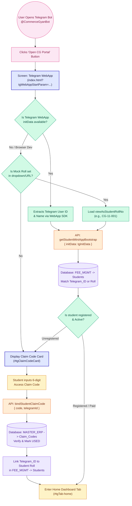
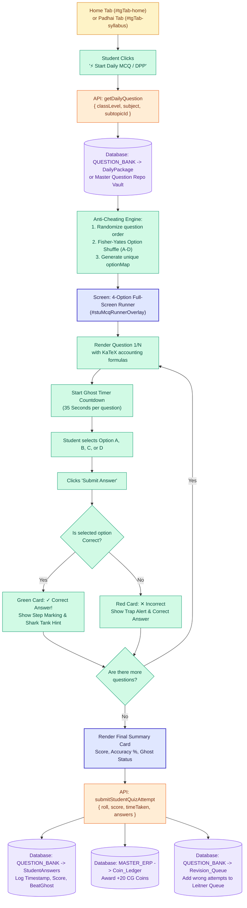
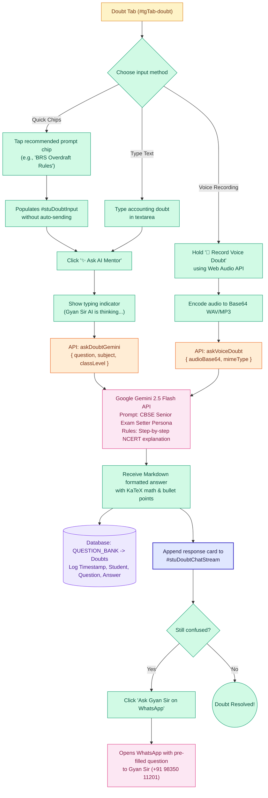

# COMMERCE GYAN MASTER APP — COMPREHENSIVE USER JOURNEY FLOWCHARTS

> **Flowchart Standards:** Formatted in strict Mermaid syntax with multi-color domain styling:  
> 🔵 **Screens/Pages** (`#E0E7FF`) | 🟡 **Tabs** (`#FEF3C7`) | 🟢 **Functions/Logic** (`#D1FAE5`) | 🟠 **APIs/Backend** (`#FFEDD5`) | 🟣 **Database/Sheets** (`#EDE9FE`) | 🔴 **External Integrations** (`#FCE7F3`)

---

## 1. Student Onboarding & Authentication Flow

Explains how a student opens the Telegram Mini App, verifies their claim code, and enters their personalized portal.

---

## 2. Daily Student Learning & Practice Flow

Traces how a student takes their Daily MCQ / DPP, competes with the Ghost Timer, and earns CG Coins.

---

## 3. Teacher Live Class Session & Attendance Flow

Traces how Gyan Sir conducts an offline or live class, takes attendance in 30 seconds, and publishes lecture notes.

```mermaid
flowchart TD
    classDef scr fill:#E0E7FF,stroke:#4338CA,stroke-width:2px,color:#1E1B4B;
    classDef tab fill:#FEF3C7,stroke:#D97706,stroke-width:1px,color:#78350F;
    classDef fn fill:#D1FAE5,stroke:#059669,stroke-width:1px,color:#064E3B;
    classDef api fill:#FFEDD5,stroke:#EA580C,stroke-width:1px,color:#7C2D12;
    classDef db fill:#EDE9FE,stroke:#7C3AED,stroke-width:1px,color:#4C1D95;
    classDef ext fill:#FCE7F3,stroke:#DB2777,stroke-width:1px,color:#831843;

    OPS["Teacher Daily Ops Workspace<br/>(#teacherOpsWorkspace)"]:::scr
    OPS --> TAB_TOPIC["Topic Tab (#opsTab-topic)"]:::tab
    
    TAB_TOPIC --> LOCK_TOPIC["Select Chapter & Subtopic<br/>Click 'Lock Topic for Today'"]:::fn
    LOCK_TOPIC --> API_LOCK["API: setActiveSubtopic<br/>{ subtopicId, deliveryMode }"]:::api
    API_LOCK --> DB_LOCK[("Database: TELEGRAM -> Settings!B2<br/>& MASTER_ERP -> Weekly_Timetable")]:::db
    
    DB_LOCK --> TAB_START["Start Tab (#opsTab-start)"]:::tab
    TAB_START --> CLICK_START["Select Batch & Mode<br/>Click 'Start Class Session'"]:::fn
    CLICK_START --> API_START["API: startClassSession<br/>{ batch, topicId, deliveryMode }"]:::api
    API_START --> DB_SESS[("Database: MASTER_ERP -> Class_Sessions<br/>Create Session ID, Record Start Time")]:::db
    
    DB_SESS --> TAB_ATT["Classroom Attendance Grid<br/>(#subtab-classroom-attendance)"]:::tab
    TAB_ATT --> TOGGLE_ATT["Gyan Sir taps P / A / L<br/>for all batch students (30 seconds)"]:::fn
    TOGGLE_ATT --> CLICK_SAVE_ATT["Click 'Save Batch Attendance'"]:::fn
    CLICK_SAVE_ATT --> API_ATT["API: saveAttendanceBatch<br/>{ batch, date, records: [{roll, status}] }"]:::api
    API_ATT --> DB_ATT[("Database: MASTER_ERP -> Attendance_Logs<br/>Append batch attendance rows")]:::db
    
    API_ATT --> CHECK_ABSENT{"Any Absent<br/>students?"}:::fn
    CHECK_ABSENT -->|Yes| API_ALERT["API: sendClassMissedNotices<br/>Trigger REC-01 Recovery Alerts"]:::api
    API_ALERT --> TG_PARENT["Telegram Bot sends absent alert<br/>to parent mobile"]:::ext
    CHECK_ABSENT -->|No| CLASS_RUNS["Class session proceeds..."]:::fn
    
    CLASS_RUNS --> TAB_END["End Tab (#opsTab-end)"]:::tab
    TAB_END --> PASTE_PDF["Paste GoodNotes Google Drive URL<br/>of exported chalkboard notes"]:::fn
    PASTE_PDF --> CLICK_END["Click 'End Class Session'"]:::fn
    CLICK_END --> API_END["API: endClassSession<br/>{ sessionId, goodnotesUrl, outcome }"]:::api
    API_END --> DB_END[("Database: MASTER_ERP -> Daily_Class_Recordings<br/>Save PDF link & Mark Topic Completed")]:::db
    DB_END --> SYNC_STU["Student Padhai Tab now displays<br/>'📄 Offline GoodNotes PDF' link"]:::tab
```

---

## 4. Doubt Solving & Voice Question Flow

Explains how students submit academic doubts and receive NCERT-compliant AI guidance.

---

## 5. Red-Pen Subjective Copy Checking Flow

Traces how handwritten register solutions are uploaded, stored in Google Drive, and graded.

```mermaid
flowchart TD
    classDef scr fill:#E0E7FF,stroke:#4338CA,stroke-width:2px,color:#1E1B4B;
    classDef tab fill:#FEF3C7,stroke:#D97706,stroke-width:1px,color:#78350F;
    classDef fn fill:#D1FAE5,stroke:#059669,stroke-width:1px,color:#064E3B;
    classDef api fill:#FFEDD5,stroke:#EA580C,stroke-width:1px,color:#7C2D12;
    classDef db fill:#EDE9FE,stroke:#7C3AED,stroke-width:1px,color:#4C1D95;
    classDef ext fill:#FCE7F3,stroke:#DB2777,stroke-width:1px,color:#831843;

    PROG_TAB["Progress Tab (#tgTab-progress)"]:::tab
    PROG_TAB --> CLICK_REDPEN["Click '✍️ Open Red-Pen' Button"]:::fn
    
    CLICK_REDPEN --> MODAL["Screen: Red-Pen Upload Modal<br/>(#stuRedPenModal)"]:::scr
    
    MODAL --> SELECT_SUBJ["Select Subject (e.g. Accountancy)"]:::fn
    SELECT_SUBJ --> CAPTURE_PHOTO["Take photo of register page<br/>or select file from gallery"]:::fn
    
    CAPTURE_PHOTO --> PREVIEW["Preview image thumbnail<br/>Add optional note for Gyan Sir"]:::fn
    PREVIEW --> CLICK_UPLOAD["Click 'Submit for Red-Pen Analysis'"]:::fn
    
    CLICK_UPLOAD --> CLIENT_COMPRESS["Compress image client-side<br/>to reduce upload payload"]:::fn
    CLIENT_COMPRESS --> API_REDPEN["API: submitRedPenCopy<br/>{ imageBase64, roll, subject, note }"]:::api
    
    API_REDPEN --> DRIVE["Google Drive API<br/>Folder: Commerce Gyan Red-Pen Uploads<br/>Save image file and get public URL"]:::ext
    
    DRIVE --> OCR_AUDIT["Gemini 2.5 Flash Vision API<br/>1. OCR handwritten text & tables<br/>2. Verify if valid student register<br/>3. Audit against 5-step CBSE rubric"]:::ext
    
    OCR_AUDIT --> DB_REDPEN[("Database: QUESTION_BANK -> Student_Red_Pen<br/>Save Roll, Subject, Drive_URL, Status, Feedback")]:::db
    
    DB_REDPEN --> TOAST_SUCCESS["Show success toast notification:<br/>'✓ Copy submitted to Gyan Sir!'"]:::fn
    TOAST_SUCCESS --> CLOSE_MODAL["Close modal and update<br/>Past Checked Copies count in Progress tab"]:::tab
```

---

## 6. Fee Calculation & Dynamic UPI QR Payment Flow

Traces how tuition dues are calculated, displayed to parents, paid via UPI, and verified with SWOT receipts.

```mermaid
flowchart TD
    classDef scr fill:#E0E7FF,stroke:#4338CA,stroke-width:2px,color:#1E1B4B;
    classDef tab fill:#FEF3C7,stroke:#D97706,stroke-width:1px,color:#78350F;
    classDef fn fill:#D1FAE5,stroke:#059669,stroke-width:1px,color:#064E3B;
    classDef api fill:#FFEDD5,stroke:#EA580C,stroke-width:1px,color:#7C2D12;
    classDef db fill:#EDE9FE,stroke:#7C3AED,stroke-width:1px,color:#4C1D95;
    classDef ext fill:#FCE7F3,stroke:#DB2777,stroke-width:1px,color:#831843;

    FEES_TAB["Fees Tab (#tgTab-fees)"]:::tab
    FEES_TAB --> CALC_LOGIC["Backend Fee Calculation Engine:<br/>1. Base Fee (Monthly Combo ₹1,200 / Quarterly ₹3,300)<br/>2. Less: Promise / Sibling Discount (-10%)<br/>3. Less: CG Coins Redeemed (e.g. -₹50)<br/>4. Plus: Late Fee Penalty (if >10th of month)<br/>= Net Pending Dues Amount"]:::fn
    
    CALC_LOGIC --> CHOOSE_ACTION{"Parent / Student Choice"}:::fn
    
    CHOOSE_ACTION -->|Pay Now via QR| CLICK_QR["Click 'Pay Tuition via UPI QR'"]:::fn
    CLICK_QR --> QR_MODAL["Screen: UPI QR Modal (#upiQrModal)"]:::scr
    QR_MODAL --> BUILD_URI["Construct standard UPI payment URI:<br/>upi://pay?pa=commercegyan@okaxis<br/>&pn=CommerceGyan&am=1200&tn=CG-11-001"]:::fn
    BUILD_URI --> RENDER_QR["Display dynamic QR code via<br/>Google Charts Infographics API"]:::ext
    RENDER_QR --> SCAN_PAY["Parent scans with PhonePe / GPay / Paytm<br/>and completes payment"]:::ext
    
    CHOOSE_ACTION -->|Submit Payment Info| CLICK_INTIMATE["Click 'Payment ki jaankari bhejo'"]:::fn
    SCAN_PAY --> CLICK_INTIMATE
    
    CLICK_INTIMATE --> FORM["Fill Intimation Form:<br/>1. Payment Date<br/>2. Mode (UPI / Cash / Bank)<br/>3. UTR / Transaction ID (12 digits)<br/>4. Upload receipt screenshot"]:::tab
    
    FORM --> CLICK_SUBMIT_INT["Click 'Submit Intimation'"]:::fn
    CLICK_SUBMIT_INT --> API_INTIMATE["API: recordPaymentIntimation<br/>{ roll, amount, utr, mode, date }"]:::api
    
    API_INTIMATE --> DB_PAY[("Database: FEE_MGMT -> Payments<br/>Status: PENDING_VERIFICATION")]:::db
    
    DB_PAY --> TEACHER_VERIF["Teacher reviews UTR in<br/>Teacher ERP -> Finance -> Fee Ledger"]:::scr
    TEACHER_VERIF --> CLICK_VERIFY["Teacher clicks 'Verify & Mark Paid'"]:::fn
    CLICK_VERIFY --> API_VERIFY["API: recordFeePayment<br/>{ roll, voucherId, status: PAID }"]:::api
    
    API_VERIFY --> DB_UPDATE[("Database: FEE_MGMT -> Students<br/>Update Total_Paid & Clear Pending_Dues")]:::db
    DB_UPDATE --> DB_RECEIPT[("Database: FEE_MGMT -> Receipts<br/>Generate official voucher receipt")]:::db
    
    DB_RECEIPT --> SWOT_MODAL["Screen: SWOT Smart Receipt Modal<br/>(#swotModalOverlay)"]:::scr
    SWOT_MODAL --> PRINT["Click 'Print Receipt / Save PDF'<br/>Generates official tax voucher"]:::fn
```

---

## 7. Nightly 7:00 PM / 7:30 PM DPP Dispatch Automation Flow

Explains how background cron triggers assemble and deliver daily practice packages without manual human intervention.

```mermaid
flowchart TD
    classDef fn fill:#D1FAE5,stroke:#059669,stroke-width:1px,color:#064E3B;
    classDef api fill:#FFEDD5,stroke:#EA580C,stroke-width:1px,color:#7C2D12;
    classDef db fill:#EDE9FE,stroke:#7C3AED,stroke-width:1px,color:#4C1D95;
    classDef ext fill:#FCE7F3,stroke:#DB2777,stroke-width:1px,color:#831843;

    CRON(("Automated Clock Trigger<br/>Daily at 07:00 PM IST")):::ext
    CRON --> TRIG_FN["Trigger Handler: triggerNightlyDppDispatch()<br/>in backend/triggers.gs"]:::api
    
    TRIG_FN --> READ_LOCK[("Database: TELEGRAM -> Settings<br/>Read Key: ACTIVE_SUBTOPIC_11 and 12")]:::db
    
    READ_LOCK --> ASSEMBLE["70/30 Cumulative Pacing Engine:<br/>1. Fetch 7 Fresh Questions matching locked subtopic<br/>2. Fetch 3 Retention Questions from previous chapters<br/>= 10-Question Daily Package"]:::fn
    
    ASSEMBLE --> FORMAT_TG["Format Telegram Broadcast:<br/>- Batch Header (Class 11 vs 12)<br/>- Daily Challenge Rules<br/>- WebApp Deep Link (Open in CGHELP)"]:::fn
    
    FORMAT_TG --> BROADCAST["Telegram Bot API<br/>Post to Class 11 & Class 12 Channels"]:::ext
    
    BROADCAST --> LOG_DB[("Database: QUESTION_BANK -> DailyQuestions<br/>Append Date, QIDs, Class, Ghost Seconds")]:::db
    LOG_DB --> LOG_TG[("Database: TELEGRAM -> Broadcasts<br/>Record message_id and timestamp")]:::db
    
    LOG_TG --> CRON_730(("Automated Clock Trigger<br/>Daily at 07:30 PM IST")):::ext
    CRON_730 --> POST_SPEED["Telegram Bot posts Ghost Speed Challenge reminder<br/>with +20 CG Coin incentive!"]:::ext
```

