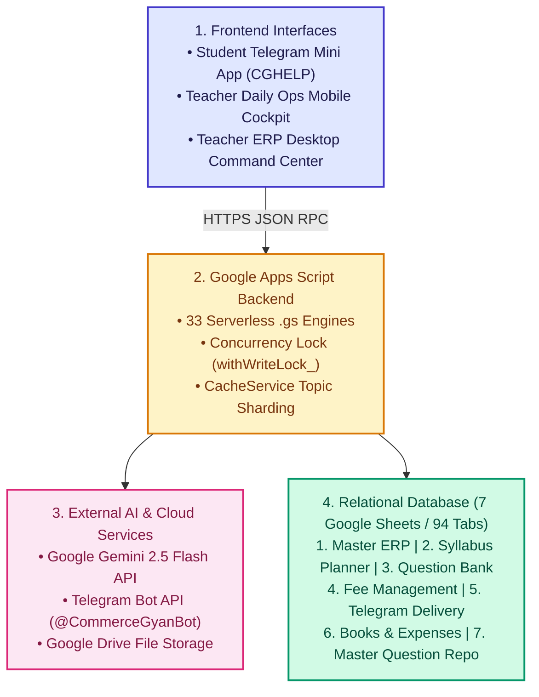

# 📂 Documentation Directory Index — Commerce Gyan Master App

> **Project Name:** Commerce Gyan Master Application & Student Telegram Mini App ("CGHELP")  
> **Repository:** `/Users/gyandeep/Documents/Commerce_mster_app` (branch: `main`)  
> **Status:** Production Audited & Deployed to Google Apps Script (`@161`)  
> **Total Documentation Volume:** 7 Comprehensive Architectural Modules (1,700+ lines)

---

## 📑 Master Navigation Index

Below is the complete table of contents for all architectural specifications, visual mind maps, user journey flowcharts, and database schemas included in this directory:

| Document Name | Focus Area & Description | Direct Link |
|:---|:---|:---:|
| **1. PROJECT_OVERVIEW.md** | Executive summary, high-level system architecture (Mermaid), 4 primary operational pillars, AI & automation engines, technical stack, and security/privacy safeguards. | [PROJECT_OVERVIEW.md](./PROJECT_OVERVIEW.md) |
| **2. COMPLETE_MINDMAP.md** | Full visual mind map (Mermaid) + detailed hierarchical tree covering every single Module ➔ Screen ➔ Tab ➔ Subtab ➔ Function ➔ API ➔ Google Sheet tab. | [COMPLETE_MINDMAP.md](./COMPLETE_MINDMAP.md) |
| **3. SCREEN_WISE_DOCUMENTATION.md** | Comprehensive 8-point specification of all 11 screens, full-screen examination overlays, and standalone admin tools (Purpose, Problem Solved, Data, Actions, APIs, Connections). | [SCREEN_WISE_DOCUMENTATION.md](./SCREEN_WISE_DOCUMENTATION.md) |
| **4. TAB_WISE_FUNCTIONALITY.md** | Granular operational guide for every individual tab and subtab across the Student App (5 tabs), Teacher Daily Ops (6 tabs), Teacher Desktop ERP (17 subtabs), and Books Manager. | [TAB_WISE_FUNCTIONALITY.md](./TAB_WISE_FUNCTIONALITY.md) |
| **5. USER_FLOWCHARTS.md** | 7 multi-color Mermaid user journey flowcharts (Student Onboarding, Daily MCQ & Speed Challenge, Teacher Live Session, Doubt Solving AI, Red-Pen Checking, Fees UPI QR, Nightly DPP). | [USER_FLOWCHARTS.md](./USER_FLOWCHARTS.md) |
| **6. API_AND_DATABASE_FLOW.md** | Complete catalog of 50+ backend API actions, request/response JSON schemas, server-side class validation, and the full relational schema of all **7 Google Sheets across 94 Tabs**. | [API_AND_DATABASE_FLOW.md](./API_AND_DATABASE_FLOW.md) |
| **7. FUNCTION_DEPENDENCY_MAP.md** | Shared frontend utilities (`cgCallGas`, `launchMcqRunner`), shared backend services (`withWriteLock_`, `requirePaidStudent_`), cross-module dependencies, and legacy audit. | [FUNCTION_DEPENDENCY_MAP.md](./FUNCTION_DEPENDENCY_MAP.md) |

---

## 🏛️ Quick Architecture Overview

---

## 💡 How to Use This Documentation
* **For High-Level Understanding:** Start with [PROJECT_OVERVIEW.md](./PROJECT_OVERVIEW.md) and [COMPLETE_MINDMAP.md](./COMPLETE_MINDMAP.md).
* **For Screen & Tab Features:** Review [SCREEN_WISE_DOCUMENTATION.md](./SCREEN_WISE_DOCUMENTATION.md) and [TAB_WISE_FUNCTIONALITY.md](./TAB_WISE_FUNCTIONALITY.md).
* **For Technical & Developer Deep-Dives:** Review [USER_FLOWCHARTS.md](./USER_FLOWCHARTS.md), [API_AND_DATABASE_FLOW.md](./API_AND_DATABASE_FLOW.md), and [FUNCTION_DEPENDENCY_MAP.md](./FUNCTION_DEPENDENCY_MAP.md).
